# INC-005: Terraform State Drift and HTTP Availability Incident

**Project:** PostureSec DevSecOps Lab  
**Date:** November 5, 2026  
**Severity:** High  
**Cloud:** AWS | **IaC:** Terraform | **Region:** us-east-1

## 1. Incident Overview

Public HTTP access to the PostureSec application was lost while the application process and database remained healthy.

The incident was triggered at **15:50:39 UTC**.
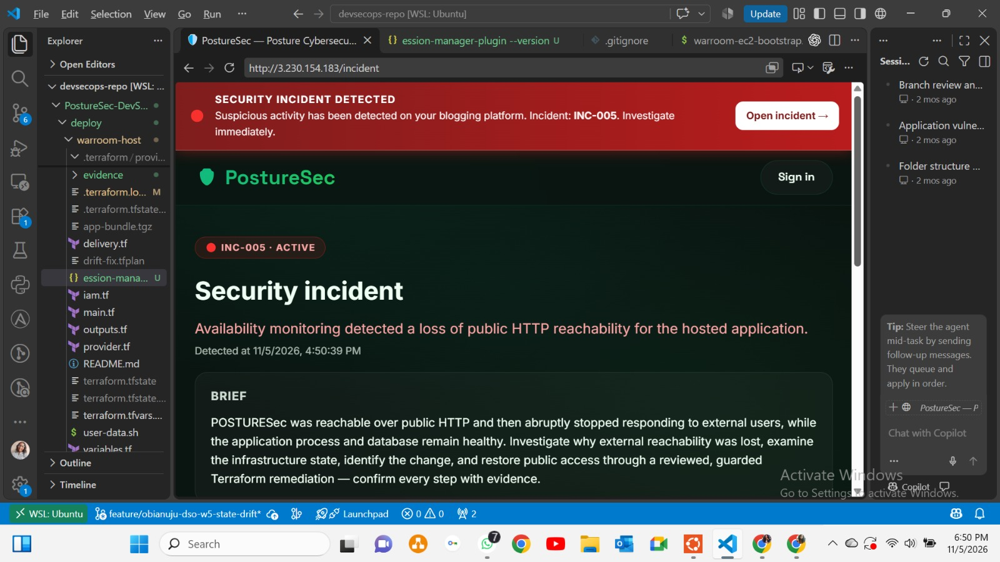
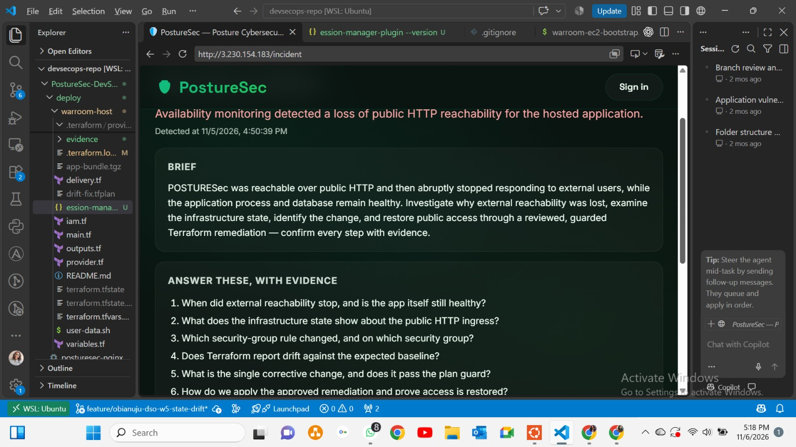

*Figure 1: INC-005 incident overview.*

## 2. Investigation and Root Cause

Inspected the EC2 containers, database, access logs and AWS security group.

The investigation identified a missing TCP port 80 ingress rule in security group `sg-0818d77259561fc29`.

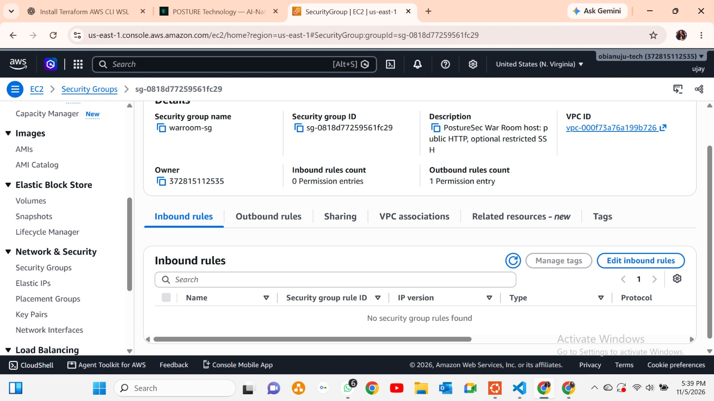
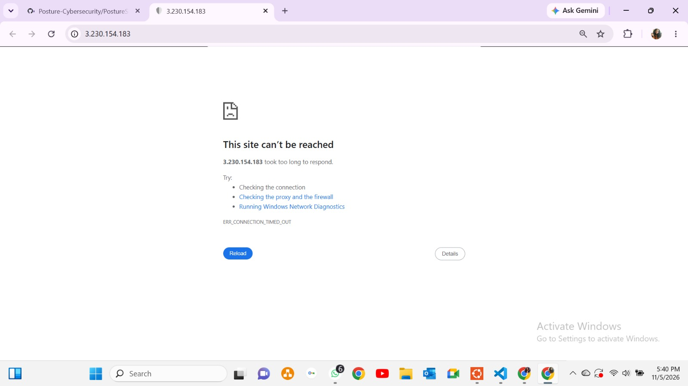
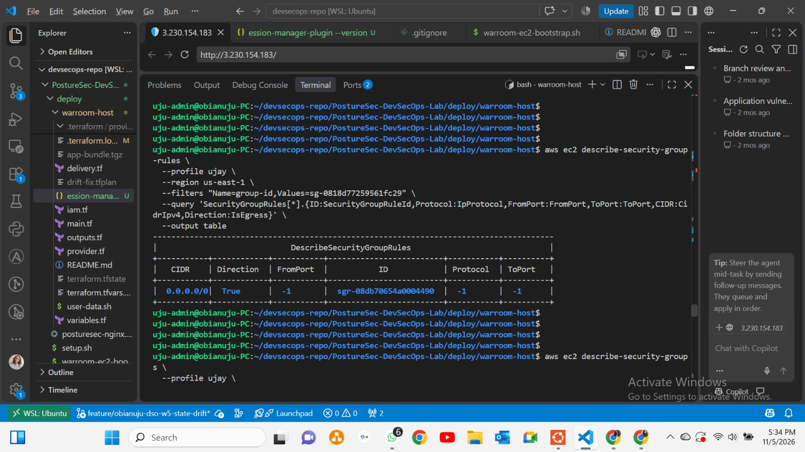
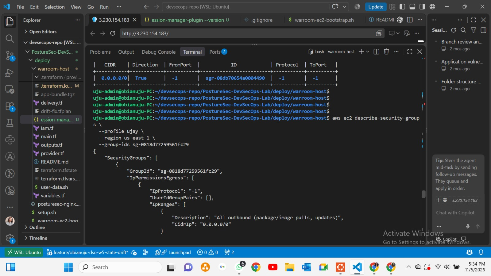
*Figure 2: Security group with the HTTP ingress rule missing.*

Backend health checks continued returning HTTP 200, confirming that the application backend remained responsive.

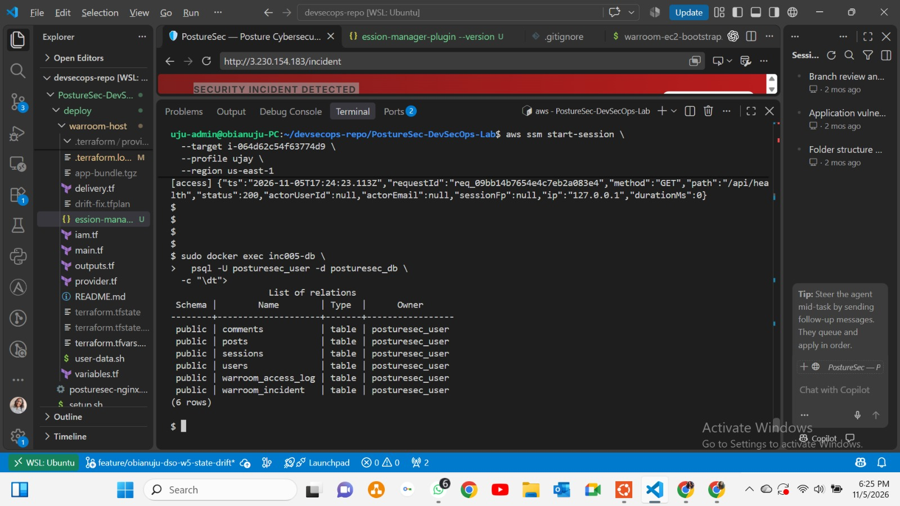
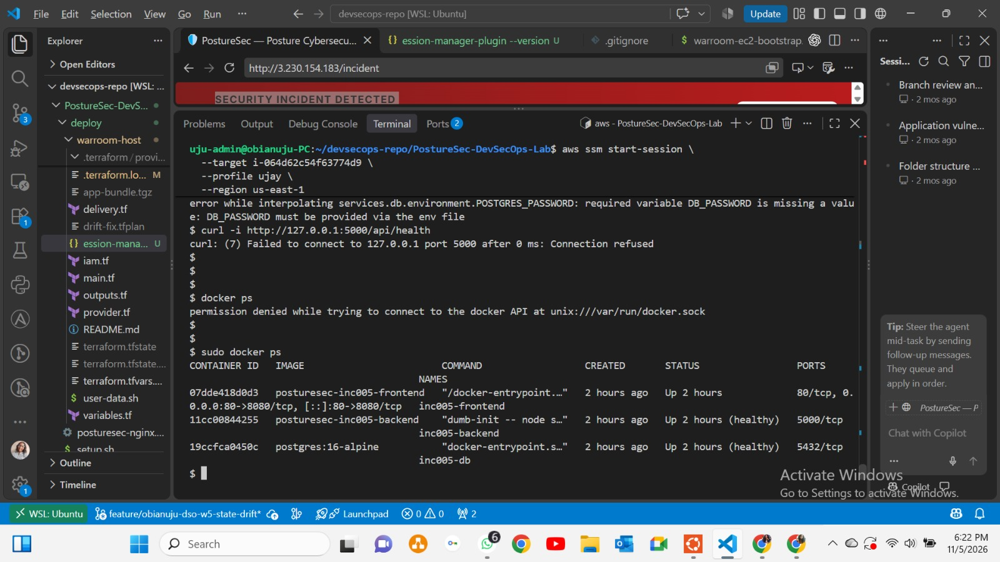

*Figure 3: Frontend, backend and database container status.*

## 3. Terraform Drift Detection

Ran Terraform plan to compare the declared infrastructure with the actual AWS environment.

Terraform detected the missing ingress resource and proposed exactly one change:

`aws_vpc_security_group_ingress_rule.http → create`

**Plan summary:** 1 to add, 0 to change, 0 to destroy.

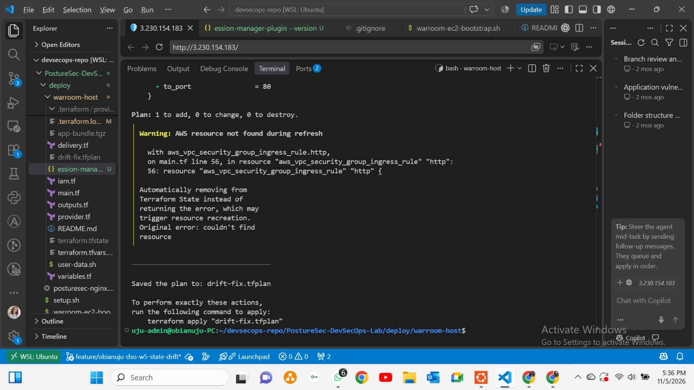

*Figure 4: Terraform identifies the missing HTTP ingress rule.*

## 4. Remediation

Applied the saved Terraform plan directly:

`terraform apply drift-fix.tfplan`

The missing HTTP ingress rule was restored.
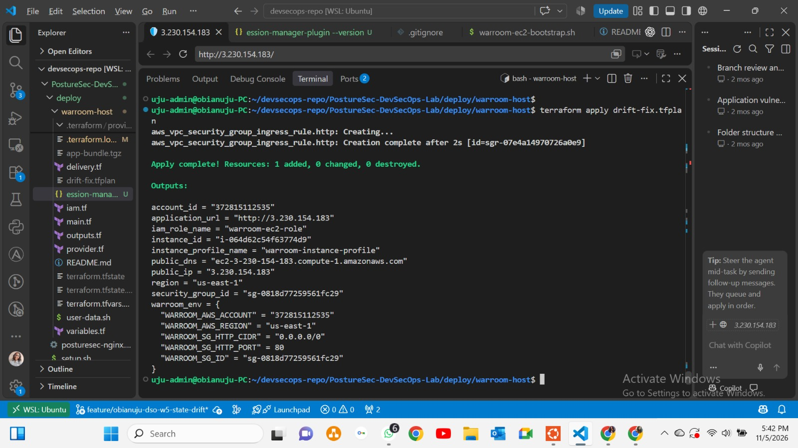

*Figure 5: Restored TCP/80 ingress rule.*

**Plan-guard note:** The application included a policy-based plan guard, but an application-level approval was not independently established. The remediation was performed through direct Terraform apply.

## 5. Recovery Verification

Tested public HTTP access:

`curl -i --max-time 10 http://3.230.154.183/incident`

Result: `HTTP/1.1 200 OK`

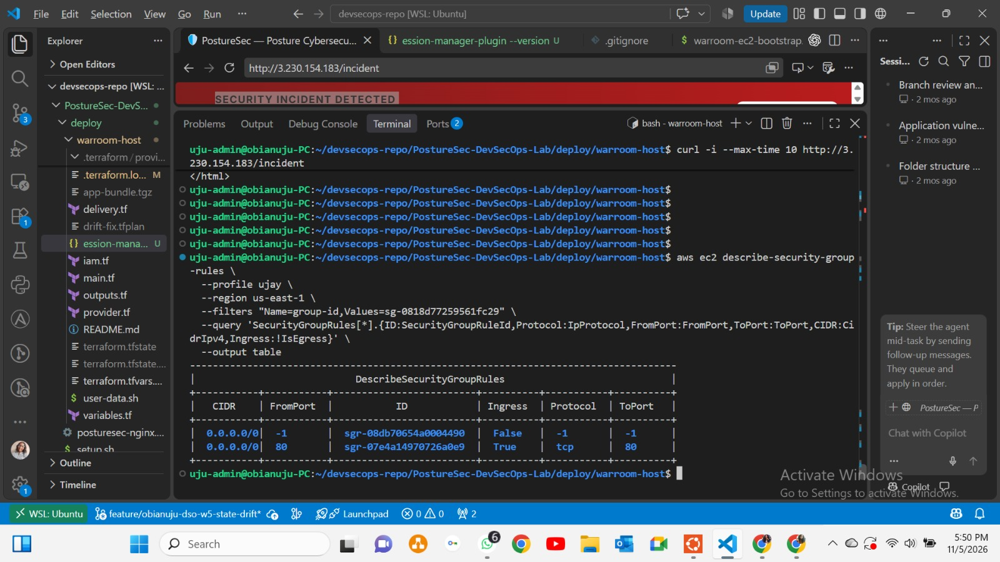
*Figure 6: External HTTP access successfully restored.*

Ran a fresh Terraform plan.

Result: **No changes. Your infrastructure matches the configuration.**

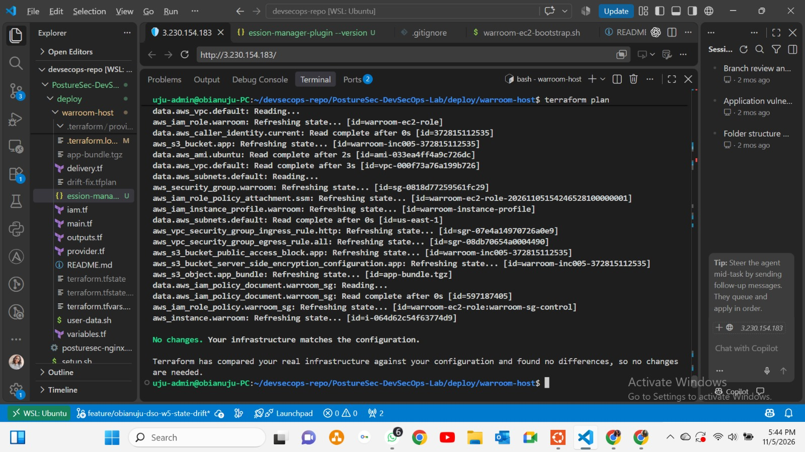

*Figure 7: Final infrastructure verification.*

## 6. Production Improvement: Automated Drift Management

For production environments, I recommend a layered automated approach:

- **GitHub Actions/Jenkins:** Run scheduled Terraform drift checks.
- **AWS Config:** Monitor resource configuration and compliance.
- **CloudTrail:** Identify who or what changed infrastructure.
- **Prometheus and Grafana:** Monitor drift results and visualize trends.
- **Alertmanager:** Notify the infrastructure team.
- **Policy guard:** Validate Terraform plan JSON and reject unauthorized changes.
- **Controlled remediation:** Require approval for sensitive changes and apply only the reviewed saved plan.
- **Post-remediation checks:** Verify Terraform state, AWS resources and application health.

**Proposed workflow:**

Scheduled Detection → Terraform Plan → Policy Validation → Alert/Approval → Controlled Apply → Verification.

This is a recommended production architecture, not a workflow fully implemented in this lab.

## 7. Lessons Learned

- Infrastructure drift can cause availability problems even when application services remain healthy.
- Terraform plan helps identify differences between declared and actual infrastructure.
- Saved plans must be reviewed before application.
- Stale plans cannot safely be reused after state changes.
- Automated remediation must include policy checks and appropriate approvals.
- Every remediation should be followed by independent verification.

## 8. Infrastructure Teardown

After completing the investigation and verification, the INC-005 AWS lab infrastructure was destroyed on November 5, 2026.

This concluded the temporary lab deployment.

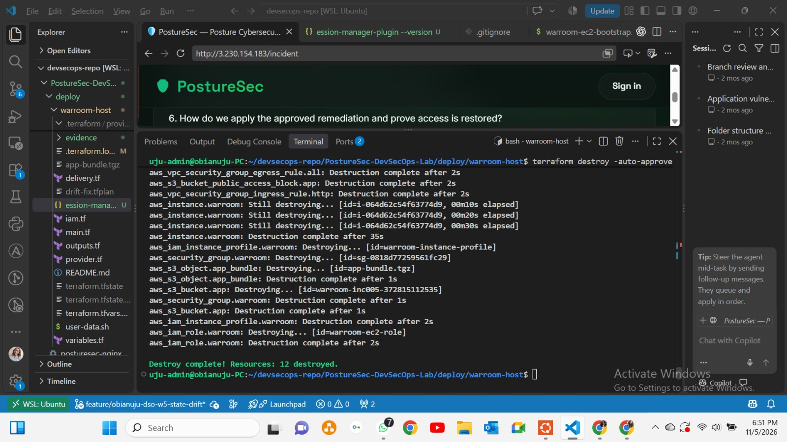

*Figure 8: Infrastructure teardown evidence.*

## Conclusion

INC-005 provided hands-on experience with AWS security groups, Terraform state drift, infrastructure remediation, application health checks and recovery verification.

The key takeaway:

**Detect drift early. Investigate the change. Validate the plan. Remediate safely. Verify the result.**
