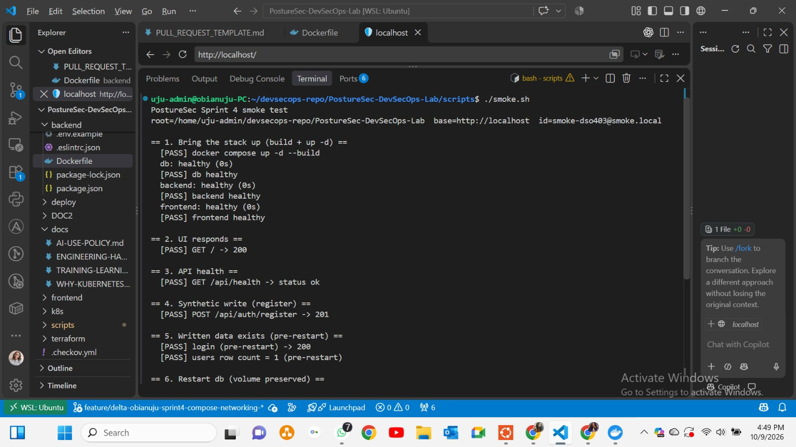

Sprint 4: Docker Compose & Service Networking
Author: Obianuju Linda Owoh
Project: PostureSec DevSecOps Lab
Tasks: DSO-401 to DSO-404
This README documents my Compose stack verification, container networking explanations, database persistence test, and assessment of Compose's production limits.
The task grouping below follows the supplied material. Confirm the task titles against the training board before submission. A successful smoke test is documented; a clean-clone test has not yet been evidenced here.

Task overview
Task	Topic	Evidence
DSO-401	Author the Compose file	Stack build and healthy service startup
DSO-402	Service networking	Networking answers and connectivity checks
DSO-403	Smoke testing and persistence	14 checks passed, 0 failed
DSO-404	Compose production limits	PostureSec scenarios and Kubernetes assessment

DSO-401: Author the Compose File
Objective
Define database, backend, and frontend services with health-aware startup order. The acceptance criterion is that docker compose up brings the full stack healthy from a clean clone.
Verification
The smoke script ran docker compose up -d --build successfully and confirmed that db, backend, and frontend were healthy. This demonstrates successful stack startup in the tested environment. Reviewing the Compose configuration is needed to confirm the explicit health-aware dependencies; testing from a fresh clone is also needed to evidence the full acceptance criterion.
Useful verification commands from the repository root:
docker compose up -d --build
docker compose ps
Screenshot space
Add screenshot: Compose service definitions, health checks, and dependency conditions.
<!-- Uncomment after adding the screenshot:

-->

Add screenshot: All three services healthy in docker compose ps.
<!-- Uncomment after adding the screenshot:

-->

Add clean-clone verification evidence here: Pending screenshot or recorded result.
DSO-402: Service Networking
Q1: Why doesn't the backend use localhost to reach the database?
Inside the backend container, localhost refers to the backend container itself. PostgreSQL runs in a separate container, so the backend connects using the database service name, such as db, and port 5432.
Q2: Why should we never hard-code a container's IP address?
A container's IP address can change when it is recreated. Using its service name lets Docker resolve the current address, keeping communication working without manually changing the configuration.
Q3: Why isn't PostgreSQL published to the host, and why is that good?
The backend can reach PostgreSQL through the internal Docker network, so publishing its port to the host is unnecessary. Keeping the database internal reduces exposure and limits direct access from outside the network. Database authentication and secure configuration are still required.
Q4: What does Docker DNS do when a container asks for backend?
Docker's internal DNS resolves backend to the backend service's container IP address on the shared Docker network. Containers can therefore communicate using service names.
Q5: What does nginx proxy_pass do with a request to /api/…?
It forwards the request to the backend and returns the backend's response to the client. Whether the /api/ prefix is preserved or removed depends on the location and proxy_pass configuration.
Q6: Why does nginx use Docker's resolver, 127.0.0.11?
127.0.0.11 is Docker's embedded DNS resolver on custom networks, including Compose networks. Nginx uses it to resolve service names such as backend. With runtime DNS resolution configured, nginx can discover a changed backend IP after the container is recreated. The resolver directive alone does not guarantee runtime re-resolution.
Connectivity check
Run from the repository root:
docker compose exec frontend wget -qO- http://backend:5000/api/health
This checks whether the frontend container can reach the backend health endpoint using the service name. -O uses uppercase letter O, and - prints the response to the terminal. A successful result for this separate command has not been supplied in this README.
Screenshot space
Add screenshot: Successful frontend-to-backend health request.
<!-- Uncomment after adding the screenshot:

-->

Add screenshot: Compose networking and nginx proxy/resolver configuration.
<!-- Uncomment after adding the screenshot:

-->

DSO-403: Smoke Test and Database Persistence
What I did
I ran smoke.sh to verify my Docker Compose setup. It built and started the database, backend, and frontend, and confirmed that all three services were healthy.
The script checked that the homepage and API responded successfully, registered a test user, and verified that the user could log in. It then restarted the database and confirmed that the same user record still existed and login still worked, demonstrating data persistence across the restart.
All 14 checks passed with no failures. The script then began cleaning up the temporary test stack and its database volume.
Command
From the repository root:
cd scripts
./smoke.sh
If the script lacks execute permission, run chmod +x smoke.sh before executing it.
Results
Check	Observed result
Build and start stack	Passed
Database, backend, frontend health	All healthy
Homepage request	HTTP 200
API health request	Status ok
Register test user	HTTP 201
Login before database restart	HTTP 200
Matching user record before restart	1
Database restart	Healthy again after 3 seconds
API recovery	Passed
Login after restart	HTTP 200
Matching user record after restart	1 — data persisted
Overall script result	14 passed, 0 failed

The test proves persistence across the database restart. It does not prove recovery from host or storage loss. The final cleanup message announces removal of the disposable stack and its volume; successful cleanup completion was not shown in the supplied output.
Screenshot space
Add screenshot: Smoke test output, including persistence proof and final result.

DSO-404: Docker Compose Production Limits and Why PostureSec May Need Kubernetes

Docker Compose makes it easy to run PostureSec's database, backend, and frontend together. It is useful for development, training, and testing. Production requires stronger support for recovering from failures, handling traffic growth, and keeping the application available.

 Limited self-healing
Compose supports restart policies that can restart a container when its process exits. However, an unhealthy container is not automatically replaced simply because its health check fails. Compose also cannot move the application to another server if its host fails.
For example, PostureSec's backend could stop responding while its process continues running. Users would be unable to log in or access posts, even though the container remains running.
Kubernetes can use liveness probes to restart an unresponsive container and readiness probes to stop sending traffic to it. In a cluster with available capacity, it can also replace workloads when a node fails.

 Limited scaling
Compose can run multiple instances of a service, but it does not provide built-in automatic scaling based on CPU usage or demand. Load balancing and published-port conflicts need additional configuration.
For example, a large training session could bring many simultaneous users to PostureSec. One backend instance might struggle to handle login, registration, and post requests.
Kubernetes can run multiple backend replicas behind a Service. With metrics and autoscaling configured, it can adjust replica counts as demand changes. The application must also support multiple instances safely.
 Single-host operation
A standard Compose deployment runs on one host. If that server fails, the frontend, backend, and database can all become unavailable. A database volume preserves data across container restarts but does not protect against losing the server or its storage.
For PostureSec, one server failure could interrupt the entire application. A multi-node Kubernetes cluster can distribute application replicas across servers and replace failed workloads on healthy nodes. PostgreSQL still needs suitable persistent storage, backups, and a recovery or high-availability plan.
Recommendation for PostureSec
Compose remains suitable for development and training. Kubernetes becomes a stronger option when PostureSec needs availability across multiple servers, automatic recovery, and scaling during traffic spikes.
The move should include health probes, multiple frontend and backend replicas, resource requests and limits, secure configuration, and a PostgreSQL storage and backup strategy. Kubernetes provides these mechanisms, but reliable operation depends on configuring and maintaining them correctly. Its additional complexity should be justified by the application's needs.

Key Lessons
- Service names provide stable references even when container IP addresses change.
- Health checks report readiness; health-aware dependencies control startup sequencing.
- Internal database networking reduces unnecessary exposure.
- The smoke test verified application responses and database persistence across a restart.
- Compose is useful for local stacks; Kubernetes adds orchestration capabilities for more demanding deployments.