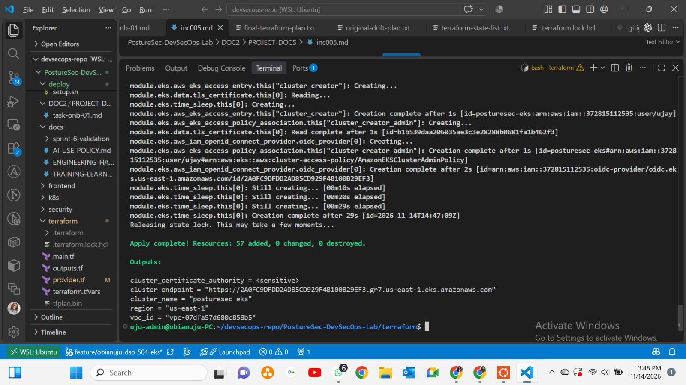
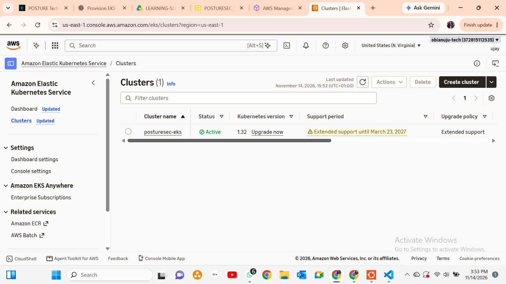
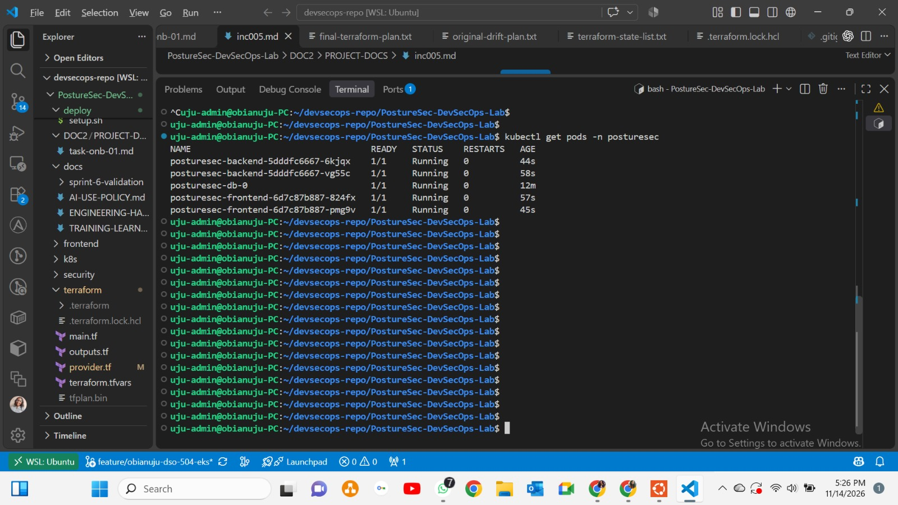
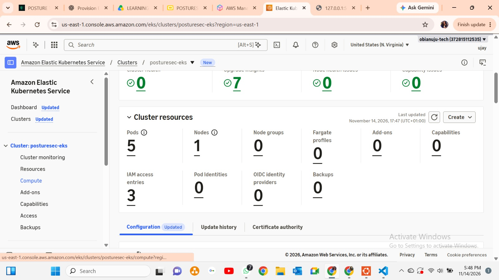
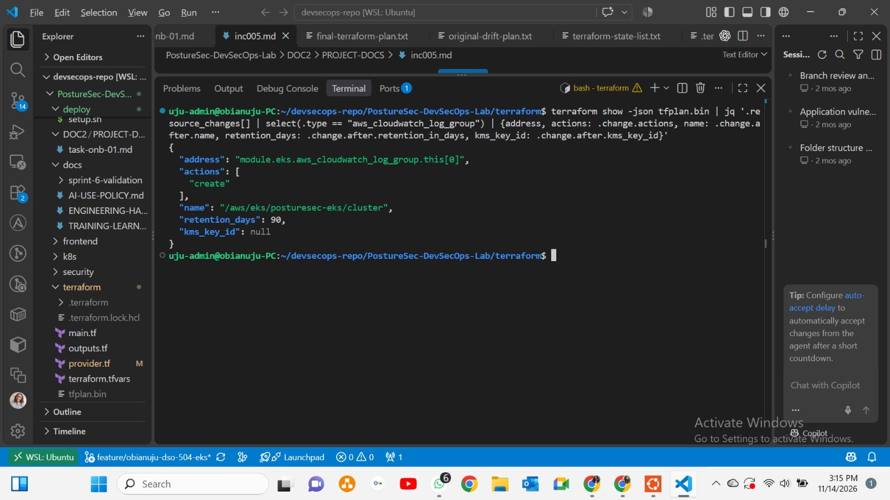
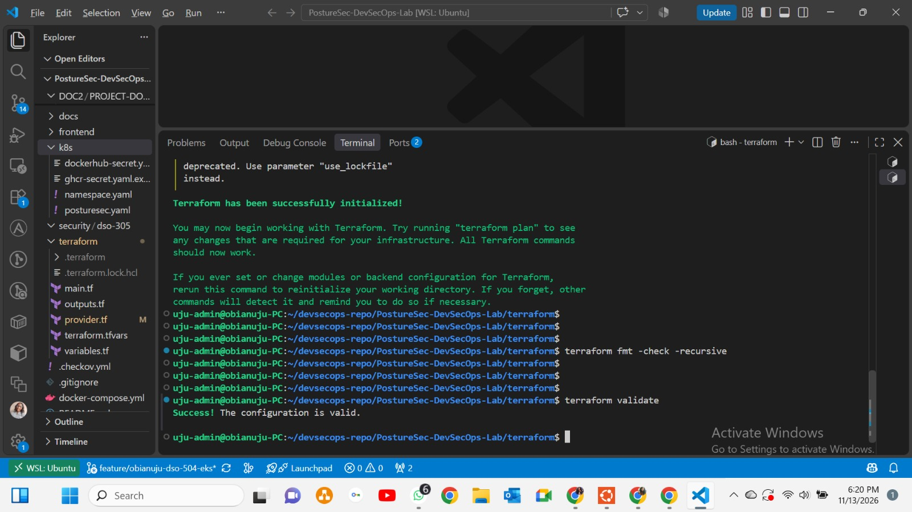
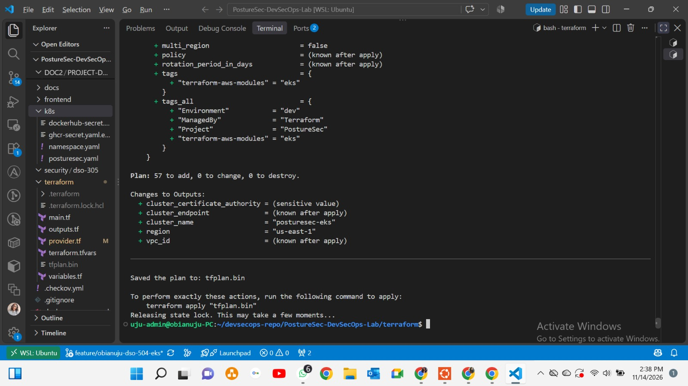

# DSO-505 — Harden the PostureSec EKS Cluster and Connect

**Sprint:** 5 — Infrastructure as Code: Terraform to EKS  
**Task:** DSO-505 — Harden the cluster & connect  
**Cloud provider:** AWS  
**Region:** `us-east-1`  
**Cluster:** `posturesec-eks`  
**Infrastructure as Code:** Terraform  
**Kubernetes:** Amazon EKS

---

## 1. Project Overview

The objective of this task was to strengthen the security configuration of an Amazon EKS cluster using Terraform, establish secure administrative access through AWS CLI and kubeconfig, and verify Kubernetes connectivity.

This exercise builds on my previous DSO-504 deployment, where I provisioned the PostureSec EKS cluster using Terraform and EKS Auto Mode.

For DSO-505, I focused on three security controls:

1. Encryption at rest using AWS KMS.
2. EKS control-plane logging.
3. Kubernetes API endpoint access restrictions.

I also configured the public API endpoint to accept connections only from my current public IP address, using a `/32` CIDR allowlist.

The final validation involved configuring kubeconfig and using `kubectl get nodes` to confirm access to the cluster.

## 2. Existing EKS Deployment Foundation

The previous DSO-504 deployment provided the foundation for this task.

The cluster configuration included:

| Component | Previous deployment configuration |
|---|---|
| Cluster name | `posturesec-eks` |
| Region | `us-east-1` |
| Kubernetes version | `1.32` |
| EKS Auto Mode | Enabled |
| General-purpose node pool | Enabled |
| System node pool | Enabled |
| Public API endpoint | Enabled |
| Private API endpoint | Enabled |
| KMS encryption | Enabled |
| Control-plane logging | Five log categories enabled |
| Authentication mode | EKS API |

The cluster was successfully provisioned using Terraform. The PostureSec application was deployed, and five Kubernetes pods reached the Running and Ready state.






## 3. Security Control 1 — Encryption at Rest

Encryption at rest protects sensitive Kubernetes data stored by the EKS control plane.

For this deployment, AWS KMS encryption was enabled for Kubernetes Secrets.

This is important because Kubernetes Secrets may contain sensitive information such as database credentials, application passwords and other configuration values.

The EKS encryption configuration uses a KMS key to protect the selected Kubernetes resources.

### Terraform configuration

The existing KMS encryption configuration from the DSO-504 Terraform implementation was retained.

The important configuration requirement is that Kubernetes Secrets are included in the EKS encryption resources.

```hcl
cluster_encryption_config = {
  provider_key_arn = module.kms.key_arn
  resources        = ["secrets"]
}
```

### Verification

After deployment, encryption can be checked through the EKS cluster configuration and AWS KMS resources.

```bash
aws eks describe-cluster \
  --name posturesec-eks \
  --region us-east-1 \
  --profile ujay \
  --query 'cluster.encryptionConfig'
```


## 4. Security Control 2 — Control-Plane Logging

EKS control-plane logging provides visibility into Kubernetes API activity and important cluster operations.

The following five log categories were enabled in the previous deployment:

| Log category | Purpose |
|---|---|
| API | Records Kubernetes API requests |
| Audit | Records actions performed against the Kubernetes API |
| Authenticator | Records authentication activity |
| Controller Manager | Records controller operations |
| Scheduler | Records pod scheduling decisions |

### Terraform configuration

```hcl
cluster_enabled_log_types = [
  "api",
  "audit",
  "authenticator",
  "controllerManager",
  "scheduler"
]
```

These logs are delivered to Amazon CloudWatch Logs.

Control-plane logging is useful for troubleshooting, security investigations, auditing and understanding activity within the cluster.

### Verification

```bash
aws eks describe-cluster \
  --name posturesec-eks \
  --region us-east-1 \
  --profile ujay \
  --query 'cluster.logging.clusterLogging'
```




## 5. Security Control 3 — Kubernetes API Endpoint Access Restrictions

The previous DSO-504 deployment enabled both public and private Kubernetes API endpoint access.

However, the supplied Terraform configuration did not explicitly define a public endpoint CIDR allowlist.

For DSO-505, I improved this configuration by restricting public endpoint access to my own public IP address.

This prevents arbitrary external IP addresses from being included in the EKS public endpoint's network allowlist.

### 5.1 Identify the current public IP address

This command can be used to obtain my public IPv4 address:

```bash
curl -4 https://checkip.amazonaws.com
```

The returned address was used as the administrator's approved public IP.

The CIDR notation `/32` represents a single IPv4 address.

For example:

```text
203.0.113.10/32
```

### 5.2 Terraform configuration

The EKS module configuration was updated to include:

```hcl
cluster_endpoint_public_access  = true
cluster_endpoint_private_access = true

cluster_endpoint_public_access_cidrs = [
  var.admin_public_ip_cidr
]
```

The corresponding variable was defined in `variables.tf`:

```hcl
variable "admin_public_ip_cidr" {
  description = "Approved public IPv4 CIDR allowed to access the EKS public API endpoint"
  type        = string
}
```

The value was supplied through `terraform.tfvars`:

```hcl
admin_public_ip_cidr = "203.0.113.10/32"
```

### 5.3 Why this restriction is necessary

The public endpoint remains enabled, but its network access is restricted to the approved CIDR range.

The private endpoint also remains enabled, allowing Kubernetes API access from within the VPC.

This provides a more controlled administrative access configuration than enabling public access without an explicit CIDR allowlist.

**Security note:** This is a network-level restriction. It does not replace IAM authentication or Kubernetes authorization.

### Verification

```bash
aws eks describe-cluster \
  --name posturesec-eks \
  --region us-east-1 \
  --profile ujay \
  --query 'cluster.resourcesVpcConfig.{PublicAccess:endpointPublicAccess,PrivateAccess:endpointPrivateAccess,AllowedCIDRs:publicAccessCidrs}'
```

The expected result should show:

- Public access enabled.
- Private access enabled.
- The approved public IP address with `/32` notation.


## 6. Terraform Validation and Deployment

After updating the Terraform configuration, I validated the infrastructure code before applying the changes.

```bash
cd terraform
terraform fmt
terraform validate
terraform plan -out=tfplan.bin
```

I reviewed the execution plan to confirm that the expected EKS security configuration would be applied.

After reviewing the plan:

```bash
terraform apply tfplan.bin
```

The deployment was monitored until the EKS cluster became Active.



successful Terraform validation and the reviewed plan.


successful Terraform apply output.

## 7. AWS CLI and kubeconfig Configuration

After the cluster became Active, I configured kubectl to communicate with the EKS cluster.

The AWS CLI profile used for this exercise was `ujay`.

### Configure kubeconfig

```bash
aws eks update-kubeconfig \
  --region us-east-1 \
  --name posturesec-eks \
  --profile ujay
```

This command retrieves the cluster connection details and updates the local kubeconfig file.

### Verify AWS identity

```bash
aws sts get-caller-identity --profile ujay
```

This confirms which AWS identity is being used by the CLI.

### Verify Kubernetes connectivity

```bash
kubectl get nodes
```

A successful response confirms that kubectl can communicate with the Kubernetes API and retrieve node information.

 
 `kubectl get nodes` showing the EKS nodes.

## 8. Understanding the AWS Authentication Chain

Connecting to an EKS cluster requires more than having the cluster endpoint.

The authentication process follows this sequence:

1. **AWS CLI credentials:** The AWS CLI uses the configured `ujay` profile to identify the IAM principal.
2. **EKS token generation:** kubectl invokes the AWS CLI authentication mechanism, which generates a short-lived EKS authentication token using `aws eks get-token`.
3. **IAM authentication:** EKS validates the token and identifies the AWS IAM principal.
4. **EKS access configuration:** The principal must be granted access through the EKS access configuration, such as an access entry or another supported authentication mapping.
5. **Kubernetes authorization:** The authenticated principal must have the appropriate Kubernetes permissions to perform the requested action.
6. **API request:** If authentication and authorization succeed, the Kubernetes API processes the request and returns the requested information.

The authentication and authorization stages are separate.

Having valid AWS credentials does not automatically mean that an IAM principal has permission to perform every Kubernetes operation.


## 9. Lessons Learned

This exercise reinforced several important EKS security concepts:

1. **Encryption at rest:** Sensitive Kubernetes Secrets should be protected using encryption mechanisms such as AWS KMS.
2. **Control-plane visibility:** Enabling API, audit and authenticator logs improves the ability to investigate cluster activity.
3. **Endpoint security:** Public endpoint access should be restricted to approved IP ranges wherever public connectivity is required.
4. **Authentication versus authorization:** AWS IAM authentication and Kubernetes permissions work together but serve different purposes.
5. **Infrastructure as Code:** Terraform makes security settings repeatable, reviewable and easier to maintain.
6. **Verification:** A successful Terraform deployment should be followed by AWS CLI and kubectl checks to confirm the intended configuration and actual connectivity.

## 10. Conclusion

DSO-505 builds on my previous hands-on experience deploying PostureSec on Amazon EKS with Terraform.

The task focuses on strengthening the cluster's security posture through KMS encryption, control-plane logging and restricted API endpoint access.

By explicitly configuring a public CIDR allowlist, the cluster's public Kubernetes API endpoint can be limited to my approved administrative IP address while retaining private endpoint access.

Finally, AWS CLI and kubeconfig provide the authentication path required to connect to the cluster, while `kubectl get nodes` verifies successful Kubernetes API access.

**Final outcome:** The objective is to deploy and verify an EKS cluster with all three security controls enabled, public API access restricted to the approved administrator IP, and successful Kubernetes connectivity.

