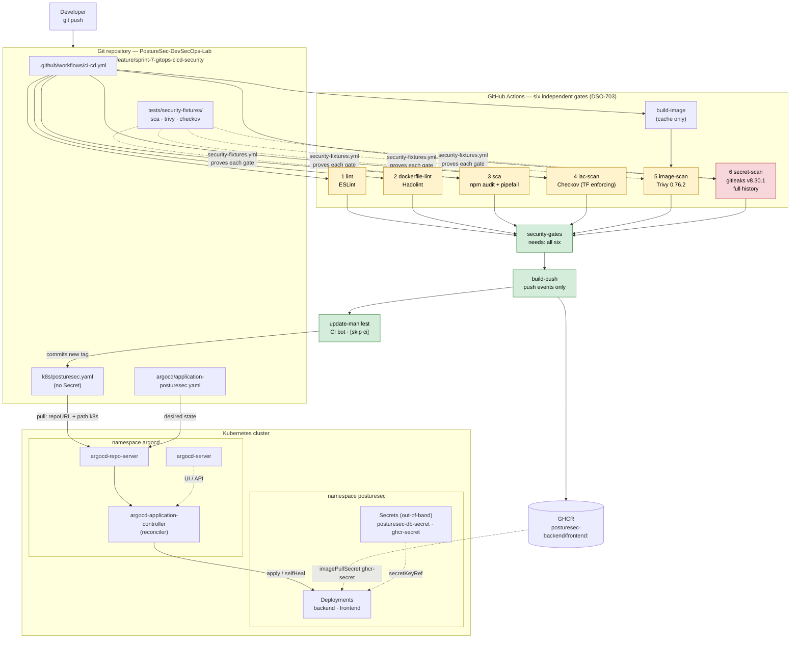
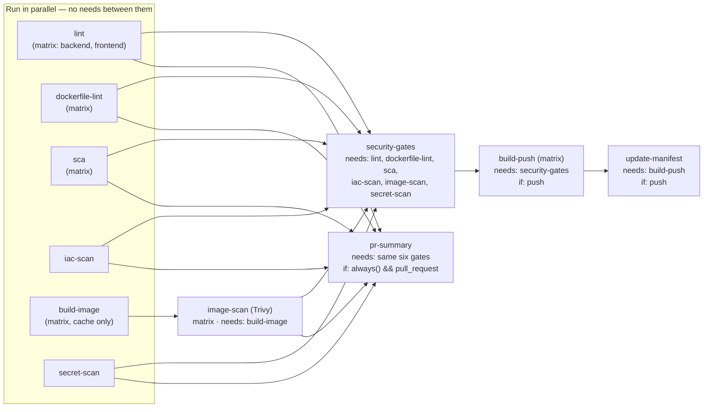
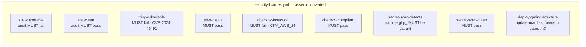

# SPRINT 7 — INSTRUCTOR TEACHING HANDOFF

**POSTURE ACADEMY — GitOps & the CI/CD Security Pipeline**

| | |
|---|---|
| **Repository** | `PostureSec-DevSecOps-Lab` (`Posture-Cybersecurity/PostureSec-DevSecOps-Lab`) |
| **Branch inspected** | `feature/sprint-7-gitops-cicd-security` |
| **Worktree** | `PostureSec-sprint7-wt` |
| **Commit inspected** | `f7197b8` — *"docs(sprint-7): add evidence-backed instructor handoff"* (2026-11-17 15:25 +0100) |
| **Working tree** | Clean. Local `HEAD` == `origin` (`f7197b8`). Nothing unpushed. |
| **Merge base with `dev`** | `87544ba`. 19 commits on this branch. |
| **Method** | Read-only inspection. No file modified, committed, pushed, deployed or rotated. No AWS resource created. No credential value printed, decoded or copied. |

> **Scope note for the instructor.** The implementation is *complete and committed*. This
> document teaches it. Where a claim could be checked against the actual file, it was checked;
> where the existing docs said something the code contradicts, the contradiction is recorded
> (see §9).

---

## 0. Reading guide — evidence classes

Every factual claim in this handoff carries one of these labels. They are **not** interchangeable.

| Label | Meaning |
|---|---|
| **[VERIFIED]** | I read the file on branch `f7197b8` and confirmed the behaviour described. |
| **[CI]** | Proven by a real GitHub Actions run. Run ID and conclusion re-checked through the GitHub API. |
| **[LOCAL]** | Proven by a local CLI run, recorded in `LOCAL-VALIDATION.md`, reproduced on the author's machine. Not re-run during this inspection. |
| **[LIVE]** | Demonstrated on a real Kubernetes cluster. **See the health warning below.** |
| **[OFFLINE]** | Schema/YAML-level validation only. Nothing executed against a cluster. |
| **[UNVERIFIED]** | Reported in a document, but the supporting artefact is not retrievable. |
| **[NOT-DEMO]** | Explicitly not demonstrated. Do not claim it. |

> ### ⚠️ The one honesty rule for this sprint
> The live GitOps demonstration (DSO-701/702/704) used **a public `nginx` image served from an
> in-cluster `git daemon`**. It was **not** a deployment of the POSTURESec application.
> The Argo CD *mechanics* are identical; the *artefact* is not.
> **Never present the Nginx demo as a POSTURESec deployment.**

---

## 1. The sprint in one page

Sprint 7 turns a **green-by-design** pipeline into one whose security gates genuinely block,
and then hands deployment to **GitOps** so the cluster pulls reviewed state from Git instead
of CI pushing to it.

The five tickets form a single arc:

1. **DSO-703** — the gates were theatre (`continue-on-error` everywhere). Make them enforce, then decouple them so one failure no longer hides another, and gate publish/deploy behind an aggregate.
2. **DSO-705** — add secret scanning; it immediately catches a genuine committed database password. Teach that *detection* is not *response*: rotation is the fix, history is the ghost.
3. **DSO-701** — install Argo CD: the reconciliation controller GitOps requires.
4. **DSO-702** — declare an `Application` so Argo CD continuously syncs `k8s/` into the cluster.
5. **DSO-704** — the CI bot writes the new image tag *into Git*; Argo CD notices and deploys. Rollback becomes `git revert`.

**The thesis students should leave with:** *a scanner that runs is not a gate that enforces,
and a deploy you do by hand is not GitOps.*

---

## 2. DSO-701 — Install Argo CD

### A. What problem does this ticket solve?

Before GitOps, deployment is an **imperative push**. Someone or some CI job holds cluster
credentials and runs `kubectl apply`, `helm upgrade`, or `kubectl set image`. Three consequences:

1. **CI holds cluster credentials.** A compromised pipeline can do anything the cluster can.
2. **Drift is invisible.** Someone `kubectl edit`s a Deployment at 2 a.m.; nothing records it and nothing reverts it.
3. **The running state is not the repository.** You cannot audit "what is deployed" by reading Git.

GitOps inverts this: an in-cluster agent **pulls** the declared state from Git and continuously
reconciles reality to it. Argo CD is that agent. You cannot have GitOps without a
reconciliation controller — Git alone is a passive store; *something inside the cluster* must
watch it.

### B. What are we teaching?

The five GitOps principles and how each maps to a concrete Argo CD behaviour
(`07-DSO-701-GITOPS-AND-ARGOCD.md:7-13`):

| Principle | What it means | Argo CD mechanism |
|---|---|---|
| Declarative | Desired state is described, not scripted | You commit manifests; Argo CD applies them |
| Git is the single source of truth | The repo, not a console, defines what runs | Argo CD syncs *from* Git; console edits are drift |
| Continuous reconciliation | An agent constantly compares desired vs live | Controller reports `Synced` / `OutOfSync` |
| Pull-based | The cluster pulls; CI needs no cluster creds | In-cluster controller fetches from Git |
| Drift detection & self-heal | Out-of-band changes are reverted | `selfHeal: true` |

**The security lesson** (`07-DSO-701-GITOPS-AND-ARGOCD.md:15-17`): the deployed state becomes
auditable (Git history), reviewable (PRs), and recoverable (`git revert`) — and **CI never holds
cluster credentials**, which shrinks the blast radius of a CI compromise.

### C. How does the implementation work?

**Files:**

| File | Purpose | Why it exists |
|---|---|---|
| `argocd/namespace.yaml` | 6-line `Namespace` named `argocd` with a `part-of` label | Everything Argo CD ships must land in a namespace that exists first |
| `argocd/install.yaml` | 37,254-line vendored official **Argo CD v3.6.1** install manifest | The exact install bytes are committed, so the version is pinned and upgrades are a reviewable diff |
| `argocd/README.md` | Install, access, hardening commands | Quick reference for the instructor |

**[VERIFIED] `argocd/install.yaml` object inventory** (counted from the file, `^kind:` lines):

```
9 x Service              7 x NetworkPolicy        7 x ServiceAccount
6 x Deployment           6 x Role  / 6 x RoleBinding
7 x ConfigMap            3 x CustomResourceDefinition
3 x ClusterRole / 3 x ClusterRoleBinding   2 x Secret   1 x StatefulSet   (+ Namespace)
```
Image pinned: `quay.io/argoproj/argocd:v3.6.1`.

**What each component does** — teach this as a diagram, not a list:

| Component | Kind | Role |
|---|---|---|
| `argocd-application-controller` | **StatefulSet** | The reconciler. Compares Git to live and drives the cluster to match. The heart of GitOps. |
| `argocd-repo-server` | Deployment | Clones the Git repo, renders Helm/Kustomize/plain YAML into manifests. The only component that talks to Git. |
| `argocd-server` | Deployment | API + web UI + CLI endpoint. Does *not* do reconciliation. |
| `argocd-redis` | Deployment | Cache for the (expensive) rendered manifests. |
| `argocd-dex-server` | Deployment | Optional SSO broker. **Argo CD runs fine without it.** |
| `argocd-applicationset-controller` | Deployment | Optional: generate many Applications from one template. |
| `argocd-notifications-controller` | Deployment | Optional: notify on sync/health events. |

**What breaks if it is wrong** — these are real, from the live run:

- **Missing `namespace.yaml`** → `kubectl apply -n argocd` fails with `namespaces "argocd" not found`.
- **Applied client-side instead of `--server-side`** → the Argo CD CRDs exceed the `kubectl.kubernetes.io/last-applied-configuration` annotation size limit and the apply errors out.
- **Redis absent when `argocd-server` starts** → `CreateContainerConfigError: secret "argocd-redis" not found`, because redis *generates* that auth secret on start. A cascading failure that points at a dependency, not at the broken pod.
- **Dex absent** → harmless; SSO only.

### D. Practical walkthrough

**Sequence and commands as they exist in the repo.** Note the repo contains *two* variants —
learn the difference, it is itself a lesson.

**Variant 1 — `argocd/README.md:10-15` (generic local cluster):**
```bash
minikube start --driver=docker
kubectl apply -f argocd/namespace.yaml
kubectl apply -n argocd -f argocd/install.yaml
kubectl -n argocd rollout status deploy/argocd-server --timeout=300s
```

**Variant 2 — `07-DSO-701-GITOPS-AND-ARGOCD.md:27-32` (same, hardened):**
```bash
minikube start --driver=docker
kubectl apply -f argocd/namespace.yaml
kubectl apply -n argocd -f argocd/install.yaml --server-side # --server-side avoids CRD "annotation too long"
kubectl -n argocd rollout status deploy/argocd-server --timeout=300s
```

> **Teach this discrepancy explicitly.** The README omits `--server-side`; doc 07 and the live
> runbook (`10-...LIVE-GITOPS.md:44`) use it. On a strict API server the README form can fail.
> The `--server-side` form is the correct one. Draw the parallel with DSO-705: *two documents,
> one truthful — read the code, not just the doc.*

**What each command does / what students should see:**

| Command | What it does | Expected observation |
|---|---|---|
| `kubectl apply -f argocd/namespace.yaml` | Creates the namespace | `namespace/argocd created` |
| `kubectl apply -n argocd -f argocd/install.yaml --server-side` | Installs every Argo CD object into `argocd` | A long `configured`/`created` list — 60+ objects |
| `kubectl -n argocd rollout status deploy/argocd-server --timeout=300s` | Blocks until `argocd-server` is ready | `deployment "argocd-server" successfully rolled out` |
| `kubectl -n argocd get pods` | Health check | **7 pods `Running 1/1`** |

**Access + first-login hardening (`07-DSO-701-GITOPS-AND-ARGOCD.md:35-41`):**
```bash
kubectl -n argocd port-forward svc/argocd-server 8080:443 &
kubectl -n argocd get secret argocd-initial-admin-secret -o jsonpath='{.data.password}' | base64 -d; echo
# Log in at https://localhost:8080 (user: admin), then IMMEDIATELY:
#   argocd account update-password
kubectl -n argocd delete secret argocd-initial-admin-secret
```

> **Do not project your terminal.** The second command literally prints the bootstrap admin
> password. Describe it; do not run it on screen in front of a class. This is a DSO-705 lesson
> happening by accident in DSO-701 — use it.

**Healthy vs unhealthy states — contrast these:**

| Symptom | Diagnosis |
|---|---|
| 7/7 pods `Running 1/1` | Install healthy |
| `argocd-server` `CreateContainerConfigError` | redis not yet up — wait, do not debug the server |
| Pods `ImagePullBackOff` / endless `ContainerCreating` | Registry egress or credentials — **not** a manifest bug |
| `rollout status` times out | Read `kubectl -n argocd describe pod`, do not re-apply |

### E. Student teaching notes

**Simple explanation:** "Git is the blueprint. Argo CD is the building inspector who walks
around the site all day comparing it to the blueprint, and fixes anything that drifted."

**Deeper:** Argo CD's application controller runs a reconciliation loop. For each `Application`
it asks the repo-server for the rendered desired state at a specific commit, fetches the live
state from the API server, computes a diff, and — if `automated` is set — applies it. This is a
*control loop*, the same shape as the Kubernetes controller pattern students already met.

**Practical example:** scale a managed Deployment by hand. Without `selfHeal` it stays scaled;
with `selfHeal: true` the controller quietly reverts it. That single click is the clearest
GitOps demonstration available in a 30-second window.

**Common misunderstandings:**
- *"Argo CD is CI."* — No. It is CD/runtime reconciliation. It builds nothing.
- *"Argo CD stores my cluster credentials."* — Inverted: the cluster holds Argo CD, and Argo CD pulls from Git. CI holds nothing.
- *"I can `kubectl apply` a quick fix."* — You can; it is drift, and selfHeal will erase it.
- *"Dex is required."* — Optional SSO only.

**Questions students ask, with good answers:**
- *"What happens if GitHub is down?"* — Argo CD keeps running the last synced state; it cannot fetch new desired state. Availability is unaffected; change delivery pauses.
- *"Can Argo CD deploy to another cluster?"* — Yes, by registering that cluster's API endpoint as a destination. Here the destination is `https://kubernetes.default.svc` (in-cluster).
- *"Why pin `install.yaml` instead of applying the upstream URL?"* — Supply chain: the bytes are in your repo, reviewable, and cannot change under you.

**Knowledge check:**
1. Which Argo CD component performs reconciliation? → `argocd-application-controller`.
2. Why must `--server-side` be used? → The CRDs exceed the client-side last-applied annotation limit.
3. Manual `kubectl edit` on a selfHeal-managed resource — result? → Reverted to the Git state.
4. What are the first two things after install? → Rotate the admin password; delete the bootstrap secret.

### F. Evidence and limitations

| Claim | Class |
|---|---|
| `install.yaml` is Argo CD v3.6.1, object counts as listed | **[VERIFIED]** |
| `namespace.yaml` correct and complete | **[VERIFIED]** |
| Manifest validates as multi-doc YAML: 60 documents, 7 workloads, 3 CRDs | **[OFFLINE]** (`07-DSO-701-GITOPS-AND-ARGOCD.md:45-50`) |
| 7/7 pods Running on k3s | **[UNVERIFIED]** — reported in doc 10; no captured pod output, no log artefact, and the cluster was deleted |
| Install on AWS/production | **[NOT-DEMO]** |

> **Doc defect to pre-empt.** `07-DSO-701-GITOPS-AND-ARGOCD.md` §5 says live install was
> **PROVEN**, but its own "Evidence" section at lines 87-90 still says *"Live install not
> completed"*. §5 is the later truth; the Evidence section is stale. If a student finds the
> contradiction before you do, you lose credibility — mention it yourself.

---

## 3. DSO-702 — Integrate the application with Argo CD

### A. What problem does this ticket solve?

Argo CD installed does nothing. It needs to be **told** which repository, which path, which
branch, and which destination namespace define the application. That instruction is the
`Application` custom resource. Without it, Argo CD is an idle controller with an empty list.

### B. What are we teaching?

- The `Application` CR is the **contract between Git and the cluster**.
- **Desired state** = what the `Application` points at in Git. **Actual state** = what the cluster runs. Argo CD's job is to make the second equal the first, continuously.
- Automated sync, self-heal and prune are three **separate** powers, each with a real danger.
- Secrets are deliberately excluded from GitOps-managed state.

### C. How does the implementation work?

Two `Application` manifests exist. **The difference between them is the whole honesty story.**

**1. `argocd/application-posturesec.yaml` — the REAL app** **[VERIFIED]**:

```yaml
apiVersion: argoproj.io/v1alpha1
kind: Application
metadata:
  name: posturesec
  namespace: argocd
  finalizers:
    - resources-finalizer.argocd.argoproj.io   # cascade-delete managed resources when the App is deleted
spec:
  project: default
  source:
    repoURL: https://github.com/Posture-Cybersecurity/PostureSec-DevSecOps-Lab.git
    targetRevision: feature/sprint-7-gitops-cicd-security   # branch the CI bot commits to
    path: k8s                                               # .yaml.example templates ignored by extension
  destination:
    server: https://kubernetes.default.svc
    namespace: posturesec
  syncPolicy:
    automated:
      prune: true       # resources deleted from Git are deleted from the cluster
      selfHeal: true    # out-of-band kubectl changes are reverted
    syncOptions:
      - CreateNamespace=true
      - ApplyOutOfSyncOnly=true
  revisionHistoryLimit: 10
```

**2. `docs/sprint-7-validation/live-demo/demo-app-application.yaml` — the DEMO** **[VERIFIED]**:

```yaml
metadata: { name: demo-app, namespace: argocd }
spec:
  source:
    repoURL: git://gitserver.gitops-demo.svc:9418/demo.git   # in-cluster git daemon, public nginx
    targetRevision: main
    path: .
  destination: { server: https://kubernetes.default.svc, namespace: demo }
  syncPolicy: { automated: { prune: true, selfHeal: true }, syncOptions: [CreateNamespace=true] }
```

**Read the differences aloud to the class** — this table *is* the lesson:

| | Real app | Demo app |
|---|---|---|
| Repo | GitHub, **private**, needs a credential | In-cluster `git daemon`, **no auth** |
| Image | `ghcr.io/.../posturesec-*`, **private**, needs pull secret | Public `nginx` |
| Path | `k8s` | `.` |
| Namespace | `posturesec` | `demo` |
| Was this actually synced live? | **No** — [NOT-DEMO] | **Yes** — [LIVE]/[UNVERIFIED] |

**Secrets are deliberately NOT managed** (`application-posturesec.yaml:3-5`, `08-...md:23-28`).
After the DSO-705 remediation, `k8s/` contains **no `Secret`**. `posturesec-db-secret` and
`ghcr-secret` are created out-of-band, so Argo CD never stores or prunes a credential.
**Teach this link explicitly: DSO-705 is what makes DSO-702 safe.**

**What breaks if misconfigured:**

| Misconfiguration | Consequence |
|---|---|
| `path` left at repo root | Argo CD tries to apply `backend/`, `frontend/`, `terraform/` — chaos |
| `selfHeal: false` | Anyone's `kubectl edit` persists silently; Git no longer authoritative |
| `prune: false` | Resources deleted from Git linger in the cluster forever |
| `prune: true` with a bad `path` | **Deleted production resources.** Prune is the dangerous one |
| Secret manifest reintroduced into `k8s/` | A credential returns to Git — un-doing DSO-705 |

### D. Practical walkthrough

**Drift detection and self-heal — the safest, most visual demonstration.** From
`08-DSO-702-ARGOCD-APPLICATION.md:43-51`:

```bash
kubectl apply -f argocd/application-posturesec.yaml
argocd app get posturesec            # expect Synced / Healthy
kubectl -n posturesec scale deploy/posturesec-backend --replicas=5
argocd app get posturesec            # OutOfSync → selfHeal reverts to the Git-declared replicas
```

> **Honesty annotation for the instructor.** These commands target the **real app**, which was
> never synced. Running them today fails at step 3 for lack of credentials and cluster. They
> are the *intended* procedure, not a recorded result. Say so.

**The demo that was actually run** (`10-DSO-701-702-704-LIVE-GITOPS.md:73-79`):
```bash
kubectl apply -f demo-app-application.yaml
kubectl -n demo rollout status deploy/web --timeout=180s
kubectl -n argocd get application demo-app \
  -o jsonpath='{.status.sync.status} / {.status.health.status} @ {.status.sync.revision}{"\n"}'
# -> Synced / Healthy @ 212b867 ; image nginx:1.25-alpine ; 2 pods Running
```

Expected observation: **`Synced / Healthy`** and a commit SHA. `Synced` means Git matches the
cluster; `Healthy` means the workloads are actually well (pods ready). **They are independent
axes** — an app can be `Synced` and `Degraded` (the manifest is applied but the pod crashes).

### E. Student teaching notes

**Simple explanation:** "The Application is the address label. It says: *this repo, this
folder, this branch → that namespace.* Once attached, Argo CD never stops checking."

**Deeper:** reconciliation is a diff loop, not a one-shot deploy. `OutOfSync` is computed from
live-vs-desired comparison each sync interval. `automated` turns that diff into a corrective
action. `selfHeal` specifically covers *modifications to managed resources*; `prune` covers
*deletions of resources that left Git*.

**Practical example:** the replicas drift demo above — change by hand, watch it snap back.

**Common misunderstandings:**
- *"Synced means healthy."* — No. Two separate status fields.
- *"prune and selfHeal are the same."* — No: selfHeal reverts edits; prune deletes orphans.
- *"Argo CD needs the DB password."* — No; the Secret is out-of-band by design.

**Questions students ask, with good answers:**
- *"Why track a feature branch?"* — Because the CI bot commits image bumps there. In production you would track a promotion branch such as `main`. The manifest says so at line 17-18.
- *"Doesn't the bot push cause an infinite loop?"* — No: the bot's commit carries `[skip ci]` (DSO-704).
- *"Why is the repo credential a Secret?"* — Argo CD must authenticate to a private repo. It is read-only, created out-of-band, and gitignored (`argocd/repo-secret.yaml`).

**Knowledge check:**
1. Which two `syncPolicy` flags were enabled, and what does each do? → `prune` (delete orphans), `selfHeal` (revert drift).
2. Why does `k8s/` contain no Secret? → DSO-705; credentials must not enter Git or Argo CD's store.
3. What is the destination of the real Application? → `https://kubernetes.default.svc`, namespace `posturesec`.
4. Was the real app ever synced? → No. Representative nginx only.

### F. Evidence and limitations

| Claim | Class |
|---|---|
| `application-posturesec.yaml` is well-formed with all required fields | **[VERIFIED]** |
| It validates against the Argo CD v3.6.1 `Application` CRD schema | **[OFFLINE]** (`08-...md:31-35`) |
| Sync path inventory is `k8s/namespace.yaml` + `k8s/posturesec.yaml`, no Secret | **[VERIFIED]** — `k8s/` contains only those plus `.example` templates |
| Auto-sync → deploy → `Synced/Healthy @ 212b867` | **[UNVERIFIED]** — representative nginx; SHA not in this repo |
| Real POSTURESec app synced by Argo CD | **[NOT-DEMO]** |

---

## 4. DSO-703 — Implement CI/CD security gates that enforce and block

> This is the largest and most important ticket. Give it the most time.

### A. What problem does this ticket solve?

The pipeline already *ran* ESLint, npm-audit, Trivy, Checkov and Hadolint — and produced **green
runs on repositories with open HIGH/CRITICAL findings**. Every job carried `continue-on-error: true`;
the file's own header admitted the intent: *"Demo: … so scans can fail without blocking."*

**A security control that cannot fail the build provides zero assurance.** It generates
reports nobody reads and a reassuring green tick that is actively misleading. This ticket turns
reports into gates.

A second, subtler defect: the gates were **chained** (`lint → sca → build → image-scan`), so the
first failure *skipped* everything downstream. Trivy had never once executed on the app — its
findings were invisible, not absent.

### B. What are we teaching?

1. **Runs ≠ enforces.** The central lesson of the sprint.
2. `continue-on-error` and `|| true` are exit-code suppression.
3. **Fail-fast chaining hides evidence.** Independent jobs reveal all findings at once.
4. **Determinism.** A security test that drifts is not a test.
5. **Deployment gating.** Scanners are worthless if the artefact ships anyway.

### C. How does the implementation work?

**Primary file: `.github/workflows/ci-cd.yml` (353 lines).**

**Trigger** (line 22-26) **[VERIFIED]**:
```yaml
on:
  push:
    branches: ["**"]      # ** matches slashes; "*" alone skips feature/* branches
  pull_request:
    branches: ["**"]
```
*Why:* the original `["*"]` does **not** match `feature/x` because `*` does not cross `/`.
Pushes to feature branches produced **zero runs** — a silent, total CI blind spot.

**The six gates, individually:**

| # | Job | Tool | What it checks | Why it matters | Enforcement mechanism | If it were missing |
|---|---|---|---|---|---|---|
| 1 | `lint` | ESLint via `npm run lint`, matrix `[backend, frontend]` | JavaScript correctness/quality errors | Catches broken code and unsafe patterns before they ship | Non-zero exit fails the matrix leg | Syntax and hook-rule errors reach review |
| 2 | `dockerfile-lint` | Hadolint action v3.1.0, matrix | Dockerfile anti-patterns (unpinned base, root user, `apt` without cleanup) | Images are the attack surface; a bad Dockerfile is a supply-chain defect | `failure-threshold: warning` | Rebuildable, rootful, bloated images ship |
| 3 | `sca` | `npm audit --audit-level=high`, matrix | Vulnerable third-party dependencies | Most breaches enter through a dependency, not your code | **`set -o pipefail`** + no `\|\| true` → non-zero propagates | Known-vulnerable libraries reach production |
| 4 | `iac-scan` | Checkov action v12 | Terraform misconfiguration in `terraform/` | Infrastructure is code; a public bucket is a code defect | Terraform `soft_fail: false` | Open security groups, public buckets deploy |
| 5 | `image-scan` | Trivy `aquasec/trivy:0.76.2`, matrix | OS/library CVEs in the built image | Your dependency scan says nothing about the base image | `--severity CRITICAL,HIGH --ignore-unfixed --exit-code 1` | Base-image CVEs ship silently |
| 6 | `secret-scan` | gitleaks `v8.30.1`, `fetch-depth: 0` | Committed credentials across **full history** | History is forever; a leaked key is a live liability | `detect … --exit-code 1` | Credentials leak undetected |

**Detailed notes for the instructor:**

- **Gate 3 (`sca`), lines 93-97** — the subtle one:
  ```yaml
  run: |
    set -o pipefail
    npm audit --audit-level=high 2>&1 | tee ../npm-audit-${{ matrix.component }}.txt
  ```
  `| tee` would normally make the pipeline's exit code that of `tee` (always 0). **`set -o pipefail` is what preserves `npm audit`'s failure.** Remove it and the gate silently becomes a report. This is precisely the War Room defect. **Do not simplify this line away in the slides.**

- **Gate 4 (`iac-scan`), lines 111-129** — a **deliberate, documented exception**:
  ```yaml
  - name: Run Checkov on Terraform (gate)
    with:
      directory: terraform/
      soft_fail: false                      # ← enforcing
      skip_check: CKV_AWS_39,CKV_AWS_58     # public EKS endpoint, intentional for dev
  - name: Run Checkov on Kubernetes manifests (report-only)
    if: always()
    with:
      directory: k8s/
      soft_fail: true                       # ← documented exception, NOT a blanket bypass
  ```
  Teach the distinction: a *scoped exception with a written justification* is engineering; a
  *blanket `soft_fail: true`* is theatre. Students must be able to tell the two apart.

- **Gate 5 (`image-scan`), lines 159-192** — build once, scan the same bytes:
  ```yaml
  image-scan:
    needs: build-image        # ← ONLY build-image; NOT sca. This is the decoupling.
  ```
  `build-image` (lines 139-156) builds to `type=cacheonly` and populates the buildx GHA cache;
  `image-scan` re-loads that cache with `load: true` and scans `posturesec-<component>:scan`.
  So **Trivy scans exactly what `build-push` later publishes** — not a rebuild that could differ.

- **Gate 6 (`secret-scan`), lines 195-214** — scans history, not just the tree:
  ```yaml
  - uses: actions/checkout@v4
    with:
      fetch-depth: 0            # ← without this, gitleaks sees one commit
  ```

**The aggregator and the deployment chain — the real execution logic** (lines 217-233, 273-279) **[VERIFIED]**:

```yaml
security-gates:
  needs: [lint, dockerfile-lint, sca, iac-scan, image-scan, secret-scan]

build-push:
  needs: security-gates
  if: github.event_name == 'push'         # PRs validate but never publish

update-manifest:
  needs: build-push
  if: github.event_name == 'push'
```

**The invariant, stated precisely:** in GitHub Actions, if any job in a `needs:` list **fails**,
the dependent job is **skipped**. Therefore:

> **any one gate fails ⇒ `security-gates` skipped ⇒ `build-push` skipped ⇒ `update-manifest` skipped ⇒ nothing published, nothing deployed.**

That is the whole security property. Everything else is instrumentation.

**`pr-summary`** (lines 319-353) — a *reporter*, not a gate: `needs` the same six jobs,
`if: always() && pull_request`, posts a sticky comment with the gate table. Note the distinction
for students: this job is allowed to be non-blocking because it observes; the gates are not.

**The fixtures — how determinism is proven.** `tests/security-fixtures/` +
`.github/workflows/security-fixtures.yml` (255 lines). **Eight jobs**, each asserting an
*expectation about the scanner*, not merely running it **[VERIFIED]**:

| Job | Fixture | Assertion |
|---|---|---|
| `sca-vulnerable` | `sca/vulnerable` = `lodash@4.17.4` + lockfile | audit **must exit non-zero** AND output must contain `GHSA-35jh-r3h4-6jhm` |
| `sca-clean` | `sca/clean` = `ms@2.1.3` | audit **must exit 0** |
| `trivy-vulnerable` | `trivy/vulnerable/image.ref` = `python@sha256:b5ee…1527` | Trivy **must exit 1** AND contain `CVE-2024-45491` |
| `trivy-clean` | `trivy/clean/image.ref` = `gcr.io/distroless/static-debian12@sha256:d75c…43f2` | Trivy **must exit 0** |
| `checkov-insecure` | `checkov/insecure` (SG open `0.0.0.0/0`) | Checkov **must fail** AND flag `CKV_AWS_24` |
| `checkov-compliant` | `checkov/compliant` (SG `10.0.0.0/16`) | Checkov **must exit 0** |
| `secret-scan-detects` | `ghp_` value generated at **runtime** from `/dev/urandom` | gitleaks **must detect** |
| `secret-scan-clean` | a plain config file | gitleaks **must pass** |
| `deploy-gating-structure` | parses `ci-cd.yml` with PyYAML | `update-manifest.needs` must intersect the gate set |

**Note the inversion** — this trips students up constantly: in a normal pipeline a *failing
scanner* fails the job. In the fixtures workflow, a **vulnerable** fixture *passing* the scanner
is a **failure of the test**. Read `security-fixtures.yml:46`:
```bash
[ "$code" -ne 0 ] || { echo "::error::expected npm audit to FAIL, got exit 0"; exit 1; }
```

**Determinism on four axes for Trivy** (`01-DSO-703-EVIDENCE.md:59-61`): image **digest**,
Trivy **0.76.2**, a **frozen vuln DB** (`--skip-db-update` + cached DB key `trivy-db-2026-11-17`),
and an assertion on a **specific CVE id**, not a count. A pinned image alone is not
deterministic because the vulnerability database updates daily.

**Isolation — say this deliberately.** Fixtures live outside `./backend` and `./frontend`, so
they are never in a Docker build context, never in an image, never in `k8s/` or `terraform/`
(`tests/security-fixtures/README.md:6-10`). They are test inputs only.

### D. Practical walkthrough

**Step 1 — show the theatre** (`02-DSO-703-INSTRUCTOR-GUIDE.md:15-21`):
```bash
git show origin/dev:.github/workflows/ci-cd.yml | grep -c 'continue-on-error'
```
Expected: a count equal to the number of jobs — every gate was non-blocking. Then point at the
header comment admitting it.

**Step 2 — show the enforcing result in CI.** Open run **`44057333626`** in
`Posture-Cybersecurity/PostureSec-DevSecOps-Lab → Actions`.

Expected observation (confirmed against the GitHub API: run 95, `push`, branch
`feature/sprint-7-gitops-cicd-security`, head `09c6796`, **conclusion `failure`**):

| Gate | Result |
|---|---|
| `lint` | pass |
| `dockerfile-lint` | pass |
| `sca` | **FAIL** |
| `iac-scan` | **FAIL** |
| `image-scan` | **FAIL** — now finally runs |
| `secret-scan` | pass at this commit |
| `security-gates`, `build-push`, `update-manifest` | **skipped** |

**This red run is the success case.** Say it out loud: *a red pipeline here means the gate works.*

**Step 3 — show the fixtures run.** Open **`44055796438`** (`security-fixtures.yml`, run 2,
head `b5a1d3c`, **conclusion `success`**) — 7/7 at that commit (the two secret jobs were added
later, making 9 at `44062354609`).

**Step 4 — local reproduction** (`LOCAL-VALIDATION.md:9-20`) — the instructor can run these on
their own machine to prove the fixtures without CI:
```bash
# SCA vulnerable → expect exit 1 and GHSA-35jh-r3h4-6jhm
cd tests/security-fixtures/sca/vulnerable && npm ci && npm audit --audit-level=high

# SCA clean → expect exit 0
cd tests/security-fixtures/sca/clean && npm ci && npm audit --audit-level=high
```
```bash
# Trivy vulnerable (pinned DB) → expect exit 1, CVE-2024-45491
trivy image --severity CRITICAL,HIGH --ignore-unfixed --skip-db-update --exit-code 1 \
  python@sha256:b5ee5360b357dcd0ab2e1cc5e22fa589b6734bbd55776df6b1700994febf1527

# Trivy clean → expect exit 0
trivy image --severity CRITICAL,HIGH --ignore-unfixed --skip-db-update --exit-code 1 \
  gcr.io/distroless/static-debian12@sha256:d75cdd72874d4790092fcb1b058493ecf6bb5bf2b2b897045b00ff01d91843f2
```
```bash
# Checkov → expect exit 1 with CKV_AWS_24
checkov -d tests/security-fixtures/checkov/insecure --framework terraform
# Checkov compliant → expect exit 0
checkov -d tests/security-fixtures/checkov/compliant --framework terraform
```

**Step 5 — prove the deploy gate structurally** — point at `security-gates.needs` containing all
six, and trace the `skip` cascade on the red run.

### E. Student teaching notes

**Simple explanation:** "A smoke alarm that doesn't wake you up isn't a smoke alarm. These
scanners were beeping into an empty room."

**Deeper:** a CI job's contract is its **exit code**. Tools signal findings through exit codes;
GitHub Actions interprets non-zero as failure. Every construct that masks an exit code
(`continue-on-error: true`, `|| true`, a `| tee` without `pipefail`, a soft-fail flag) converts
an *enforcing control* into an *informational reporter*. Decoupling is orthogonal: `needs:`
creates a **skip-cascade**, which is correct for gating but wrong for evidence gathering.

**Practical example:** remove `set -o pipefail` from `sca` and re-run — the gate turns green
with the same findings printed. That is the War Room exercise in miniature.

**Common misunderstandings:**
- *"Green means secure."* — Green means *the configured checks passed*, which is only meaningful if they can fail.
- *"Trivy was broken."* — No; it was *skipped* by chained `needs`. Absence of findings was absence of execution.
- *"The fixtures are vulnerabilities we should fix."* — No; they are deliberately vulnerable *tests*.
- *"`soft_fail: true` on k8s is cheating."* — It is a documented, scoped exception with a written reason and a follow-up. A blanket bypass would be cheating. Teach the distinction.

**Questions students ask, with good answers:**
- *"Why not run everything in one job?"* — One job fails at the first error and hides the rest; independent jobs report everything in one run.
- *"Why `--ignore-unfixed`?"* — You cannot remediate a CVE with no upstream fix; blocking on it would deadlock delivery. It is a policy choice, and it is stated.
- *"Why scan the image *and* the dependencies?"* — SCA sees your `package.json`; Trivy sees the OS packages and libraries inside the built layers. Different attack surfaces.
- *"Why assert a CVE id instead of a count?"* — Counts drift as the DB updates; an id is stable and reviewable.

**Knowledge check:**
1. Name three ways a gate can run but not enforce. → `continue-on-error`, `|| true` / missing `pipefail`, `soft_fail: true` / dropped `needs` / broad allowlist.
2. What happens to `build-push` when `sca` fails? → `security-gates` is skipped, so `build-push` (needs `security-gates`) is skipped too.
3. Why does `image-scan` depend only on `build-image`? → So Trivy runs even when SCA fails; chaining it to `sca` would hide image CVEs.
4. What are the four determinism axes for the Trivy fixture? → Image digest, Trivy version, frozen DB, specific-CVE assertion.
5. Why 7/7 at `44055796438` but 9/9 at `44062354609`? → The two gitleaks fixture jobs were added later, in the DSO-705 commits.

### F. Evidence and limitations

| Claim | Class |
|---|---|
| Six gates enforce; aggregate + publish + deploy chained correctly | **[VERIFIED]** — read in `ci-cd.yml`, invariants re-checked |
| Only remaining `continue-on-error` is on `update-manifest` (deploy bot), not a gate | **[VERIFIED]** |
| `sca` failure propagates via `set -o pipefail` | **[VERIFIED]** |
| Run `44057333626` failed with publish/deploy skipped | **[CI]** — API-confirmed: run 95, `09c6796`, `failure` |
| Run `44048569920` (pre-decouple) failed | **[CI]** — API-confirmed: run 92, `7665313`, `failure` |
| Run `44055796438` fixtures 7/7 | **[CI]** — API-confirmed: `b5a1d3c`, `success` |
| Local fixture matrix vuln→fail / clean→pass | **[LOCAL]** — `LOCAL-VALIDATION.md`; not re-run in this inspection |
| App base-image CVEs are real and unresolved | **[CI]** — visible in the Trivy failure; deliberately left as posture debt |
| Checkov on `k8s/` is soft | **[VERIFIED]** — documented exception, not a bypass |

---

## 5. DSO-704 — The CI bot closes the GitOps loop and supports rollback

### A. What problem does this ticket solve?

Argo CD tracks Git. But something must **write the new image tag into Git** when CI builds a
new image — otherwise Argo CD keeps deploying the old one forever. The naive answer is for CI
to run `kubectl set image`, which drags the cluster credentials back into CI and destroys the
GitOps property. The correct answer is a **bot that commits the tag to Git**.

Rollback then becomes a Git question, not a cluster question.

### B. What are we teaching?

- **Write to Git, not to the cluster.** The deploy action of record is a commit.
- The **closed loop**: CI → Git → Argo CD → cluster.
- **Loop safety**: `[skip ci]` prevents push → CI → push recursion.
- **Rollback as VCS**: `git revert`, not `kubectl rollout undo`.
- PR feedback as a security control at review time.

### C. How does the implementation work?

**Job 1: `update-manifest`** (`.github/workflows/ci-cd.yml:274-316`) **[VERIFIED]**:

```yaml
update-manifest:
  runs-on: ubuntu-latest
  continue-on-error: true        # the ONLY remaining c-o-e; it is the deploy bot, not a gate
  needs: build-push              # ← behind the gates, transitively
  if: github.event_name == 'push'
  permissions:
    contents: write              # needed to push the manifest change
```

Steps, and what each does:
1. Checkout with `token: ${{ secrets.GITHUB_TOKEN }}`.
2. `git rev-parse --short HEAD` → the image tag.
3. Build `BACKEND_IMAGE` / `FRONTEND_IMAGE` from `GITHUB_REPOSITORY`, lowercased (GHCR requires lowercase).
4. Locate the `image:` lines with `awk` and rewrite them with `sed`:
   ```bash
   BACKEND_LINE=$(awk '/- name: backend/{found=1} found && /image:/{print NR; exit}' k8s/posturesec.yaml)
   sed -i "${BACKEND_LINE}s|.*| image: ${BACKEND_IMAGE}:${IMAGE_TAG}|" k8s/posturesec.yaml
   # ...same for frontend
   ```
5. Commit as `github-actions[bot]` with **`[skip ci]`**:
   ```bash
   git diff --cached --quiet || git commit -m "ci: update k8s images to ${{ steps.sha.outputs.short }} [skip ci]"
   git push
   ```
6. Append a GitOps hand-off block to `$GITHUB_STEP_SUMMARY`.

**Why `[skip ci]` is load-bearing:** the bot pushes to the same branch that triggers the
workflow. Without it: bot push → CI run → new build → new bot push → infinite. GitHub's
`[skip ci]` token suppresses the run. **The workflow header at line 12 calls this out.** This
single token is the difference between GitOps and a fork bomb.

**Why tags, not digests, here:** the implementation uses the short SHA. A digest
(`image@sha256:…`) is stronger — it is immutable and immune to tag mutation — and is worth
raising as an improvement discussion. Do not claim it is already done.

**Job 2: `pr-summary`** (lines 319-353) **[VERIFIED]**:
```yaml
pr-summary:
  needs: [lint, dockerfile-lint, sca, iac-scan, image-scan, secret-scan]
  if: ${{ always() && github.event_name == 'pull_request' }}
  permissions:
    pull-requests: write
```
Posts or **updates** (sticky, keyed on the `<!-- posturesec-security-gates -->` marker) a gate
table via `actions/github-script@v7`. Security posture becomes visible **at review time**, not
after merge.

**The closed loop** (`09-DSO-704-CI-BOT-LOOP.md:9-27`):
```
push → gates → build-push (GHCR) → update-manifest (commit "[skip ci]")
     → Argo CD sees new tag → sync → cluster runs the new image. No kubectl.
```

**What breaks:**
| Fault | Consequence |
|---|---|
| `[skip ci]` removed | Infinite CI loop |
| `awk`/`sed` targets drift (explain indentation) | Manifest not updated; Argo CD deploys stale image |
| `update-manifest` not `needs: build-push` | Bot bumps a tag for an image that failed a gate |
| `contents: write` granted to the whole workflow | Over-broad token (see 09-DSO-704 doc Q3) |

### D. Practical walkthrough

**What was actually run — the demo loop** (`10-DSO-701-702-704-LIVE-GITOPS.md:81-94`). Note:
**these execute inside the demo git-daemon pod, not in the repo** — that is the representative
scenario:

```bash
# 1) CI bot bumps the image in Git
kubectl -n gitops-demo exec -i "$POD" -- sh -c '
cd /work; sed -i "s|nginx:1.25-alpine|nginx:1.27-alpine|" app.yaml
git commit -aqm "ci: bump web image to nginx:1.27-alpine [skip ci]" && git push -q origin main'
kubectl -n argocd annotate application demo-app argocd.argoproj.io/refresh=hard --overwrite

# 2) Git-based rollback
kubectl -n gitops-demo exec -i "$POD" -- sh -c 'cd /work; git revert --no-edit HEAD && git push -q origin main'
kubectl -n argocd annotate application demo-app argocd.argoproj.io/refresh=hard --overwrite
```

**Expected observations** (per the runbook's results table):
| Stage | Image | Argo CD | Rev |
|---|---|---|---|
| v1 deploy | `nginx:1.25-alpine` | Synced / Healthy | `212b867` |
| bump | `nginx:1.27-alpine` | Synced / Healthy | `8c76eab` (`[skip ci]`) |
| revert | `nginx:1.25-alpine` | Synced / Healthy | `da55757` |

**The real-app path (never executed)** — `09-DSO-704-CI-BOT-LOOP.md:56-59`:
1. Push to the tracked branch; watch `update-manifest` bump and `[skip ci]`-commit.
2. `argocd app get posturesec` → new SHA appears, Synced/Healthy.
3. Open a PR → confirm the sticky gate table.

**Teach the rollback idea this way:** "In a push-based world, rollback means someone remembers
what the previous image was and runs `kubectl rollout undo`. In GitOps, rollback is `git revert`
— a reviewed, auditable commit that says exactly what changed and why. The audit trail and the
deployment are the same artefact."

### E. Student teaching notes

**Simple explanation:** "CI doesn't touch the cluster. It updates the paperwork, and the
cluster's robot reads the paperwork."

**Deeper:** this is the **separation of CI and CD** made concrete. CI's output is two things:
an immutable image (in a registry) and a *pointer* to it (a Git commit). CD's input is only the
pointer. Because the pointer is a commit, every deployment is reproducible, reversible and
attributable.

**Practical example:** the bump/revert pair above. Two commits, two deployments, zero `kubectl`.

**Common misunderstandings:**
- *"The bot deploys."* — No. The bot commits; **Argo CD** deploys.
- *"`[skip ci]` skips the security gates on the real change."* — No; the real change ran the gates. The bot's commit only changes an image tag, and the image it points to already passed.
- *"`git revert` undoes everything."* — It creates a *new* commit that inverses one commit; history is preserved, which is exactly what you want for audit.

**Questions students ask, with good answers:**
- *"If Argo CD tracks `main` but the bot commits to a feature branch, does the loop close?"* — No. The tracked revision must be the branch the bot writes to. The manifest currently tracks the feature branch for exactly this reason.
- *"Why not use image digests?"* — Better, but not implemented; it is a follow-up, not a claim.
- *"What stops a malicious bot commit?"* — Branch protection plus scoping the token to `contents: write` on a dedicated promotion branch. Not implemented here; discuss as hardening.

**Knowledge check:**
1. Why does the bot write to Git instead of running `kubectl set image`? → Git becomes the deploy record; CI holds no cluster creds.
2. What prevents the push → CI → push loop? → `[skip ci]` on the bot commit.
3. How is rollback performed? → `git revert`, then let Argo CD reconcile.
4. Why must `update-manifest` depend on `build-push`? → So a tag is never written for an image that failed a gate.

### F. Evidence and limitations

| Claim | Class |
|---|---|
| `update-manifest` correctly gated behind `build-push` behind `security-gates` | **[VERIFIED]** |
| Bot commits with `[skip ci]`, `awk`/`sed` rewrite both image lines | **[VERIFIED]** |
| `pr-summary` posts a sticky gate table on PRs | **[VERIFIED]** |
| Loop closed live: bump `8c76eab` → revert `da55757` | **[UNVERIFIED]** — representative nginx; SHAs are not objects in this repo (`git cat-file` fails) |
| Real bot editing `k8s/posturesec.yaml` → Argo CD sync | **[NOT-DEMO]** |
| `pr-summary` observed on a real PR | **[NOT-DEMO]** — no PR artefact cited |

---

## 6. DSO-705 — Secret scanning and secret management/rotation

### A. What problem does this ticket solve?

Applications need credentials. Developers put them where they are convenient — in manifests, in
config files, in comments. Git remembers **forever**: deleting a file in a later commit does not
remove it from history. Anyone who clones gets every secret ever committed.

Two distinct problems are often confused:
1. **Prevention** — stop secrets entering Git (scanning, pre-commit, push protection).
2. **Response** — limit the damage once one has entered (rotation).

This ticket implements both, and in doing so discovered a **genuine leaked database password**
that had been sitting in the repository.

### B. What are we teaching?

- What a secret *is* (a credential whose value alone grants access).
- **Detection ≠ response.** Scanning finds; rotation protects.
- **base64 is encoding, not encryption.** The "aha" of the sprint.
- Defence in depth: pre-commit → CI gate → server-side push protection.
- **History vs working tree** — the difference between the file you see and the commits you don't.
- Allowlist discipline: a false positive may be allowlisted; a finding may not.

### C. How does the implementation work?

**1. `secret-scan` job** (`.github/workflows/ci-cd.yml:195-214`) **[VERIFIED]**:
```yaml
secret-scan:
  runs-on: ubuntu-latest
  steps:
    - uses: actions/checkout@v4
      with:
        fetch-depth: 0                      # full history — the whole point
    - name: Gitleaks (detect secrets across history)
      run: |
        set +e
        docker run --rm -v "$PWD:/repo" ghcr.io/gitleaks/gitleaks:v8.30.1 \
          detect --source /repo --config /repo/.gitleaks.toml --redact \
          --report-format sarif --report-path /repo/gitleaks.sarif --exit-code 1 --no-banner
        exit $?
```
- **`fetch-depth: 0`** — the default shallow clone sees one commit; history scanning is pointless without it.
- **`--redact`** — the CI log must not become a *second* leak. Excellent teaching point: a scanner that prints the secret it found has committed a new exposure.
- **`--exit-code 1`** — the enforcement.

**2. `.gitleaks.toml`** **[VERIFIED]** — default ruleset plus a three-entry allowlist:
```toml
[extend]
useDefault = true

[allowlist]
description = "DSO-705 documented false-positives — NOT secret suppression"
paths = [
  '''.*\.example$''',                                  # templates, placeholders only
  '''backend/tests/warroom_inc003\.test\.js''',         # contains a detection REGEX as a test assertion
  '''docs/warroom/AWS-TERRAFORM-DEPLOYMENT-GUIDE\.md''',# contains a grep pattern, not a secret
]
```
**Teach the contrast:** each entry has a written reason and none of them hides a live credential.
A blanket `paths = ['''k8s/.*''']` would have hidden the real leak — that is the War Room variant F.

**3. `.pre-commit-config.yaml`** **[VERIFIED]**:
```yaml
repos:
  - repo: https://github.com/gitleaks/gitleaks
    rev: v8.30.1          # pinned
    hooks:
      - id: gitleaks
        args: ["--config", ".gitleaks.toml"]
```
Shift-left: the developer fails locally, at commit time, before anything reaches the server.
Setup: `pip install pre-commit && pre-commit install`.

**4. Remediation** — commit `2a1f121` **[VERIFIED]**:
- Removed the inline `Secret` (and the plaintext comment explaining its base64) from `k8s/posturesec.yaml`.
- Left the `secretKeyRef` / `secretRef` references intact — the app still expects the secret **by name**.
- Added a placeholder-only `k8s/posturesec-db-secret.yaml.example`.
- Gitignored the real `k8s/posturesec-db-secret.yaml`.

**Verification of the current tree** — `k8s/posturesec.yaml` now references
`posturesec-db-secret` via `secretKeyRef` only and contains **no `kind: Secret`**. `.gitignore`
covers `k8s/dockerhub-secret.yaml`, `k8s/ghcr-secret.yaml`, `k8s/posturesec-db-secret.yaml`,
`argocd/repo-secret.yaml`.

**5. Rotation runbook** — `docs/sprint-7-validation/DSO-705-SECRET-ROTATION.md`:
GHCR token (§1), PostgreSQL credentials (§2), Argo CD admin (§3), Actions secrets (§4). Golden
rule stated at line 13: *add the new secret before removing the old*, then verify, then revoke.

**What the gate actually found — run `44062354608`, `leaks found: 8`** (`04-DSO-705-EVIDENCE.md:32-38`):

| File | What it was |
|---|---|
| `k8s/posturesec.yaml` (tree + history) | A hardcoded Postgres `Secret` — base64 user/password/db |
| `k8s/jerney.yaml` (history) | The same Secret, pre-rebrand |
| `doc2/…/task-dso-103.md` (history) | A demo password in `curl` examples — low severity |

**These were deliberately NOT allowlisted.** Preserving the failure is the honest outcome —
say that explicitly, it models the behaviour you want from students.

### D. Practical walkthrough

> ⚠️ **Instructor safety rule.** Do **not** decode, echo or display the leaked credential in
> class, and do not let it appear in a slide screenshot or terminal recording. The value is
> already public in the repository's history; re-displaying it adds no teaching value and
> creates a new exposure record. Teach the *mechanism*.

**Step 1 — show the problem conceptually.** Open `k8s/posturesec.yaml` at an old revision:
```bash
git show 2a1f121^:k8s/posturesec.yaml
```
Point at `kind: Secret` and the base64 `data:` block. Explain: base64 is a **reversible
encoding**; anyone with the file can reverse it. Show the *technique* on a throwaway value of
your own, e.g. `echo -n 'not-a-real-secret' | base64 -d` — never the real one.

**Step 2 — show the gate catching it.** Open run **`44062354608`** (API-confirmed: run 97,
`push`, head `6688841`, **conclusion `failure`**). Point at the `Secret Scan` job failing while
every other gate's state is visible in the same run.

**Step 3 — show the fixtures.** Open run **`44062354609`** (`security-fixtures.yml`, head
`6688841`, **`success`**, 9/9). The two relevant jobs:
- `Secrets: planted secret MUST be detected` — generates `ghp_…` from `/dev/urandom` **at runtime** and asserts detection (`security-fixtures.yml:204-215`).
- `Secrets: clean config MUST pass` (lines 217-231).

**Step 4 — prove history still remembers.** This is the emotional peak of the ticket:
```bash
# The gate scans HISTORY. Remediating the file did not remove the old commits.
git log --oneline -S "k8s/posturesec.yaml" -- k8s/ | head
gitleaks detect --source . --config .gitleaks.toml --no-banner   # still reports history findings
gitleaks detect --source . --config .gitleaks.toml --no-git --no-banner   # working tree: clean
```
Expected: history → findings; `--no-git` → clean. **That contrast is the lesson.**

**Step 5 — the response.** Read the rotation runbook aloud: add new → update Secret out-of-band →
restart → verify → revoke old.

### E. Student teaching notes

**Simple explanation:** "A secret is like a house key. Scanning is noticing you dropped a
photocopy of it on the pavement. Rotation is changing the lock. Picking the paper up doesn't
help if a copy is already out there."

**Deeper:** secret hygiene has three layers with different failure modes.
Pre-commit is **client-side and bypassable** (`--no-verify`) but catches most accidents.
CI scanning is **authoritative but late** — the secret already reached the server.
Push protection is **server-side and un-bypassable without an explicit override**, and it is
the only layer enforced by the platform rather than by your config. Rotation is the only action
that **invalidates** an exposed value; everything else only prevents *recurrence*.

**Practical example:** the read-only vs enforcing split. A gitleaks run that prints 8 findings
but exits 0 is theatre — **exactly DSO-703's lesson reappearing**. The sprint deliberately
rhymes.

**Common misunderstandings:**
- *"I deleted the file in a new commit, so it's gone."* — The old commits still contain it. That is why the CI gate stays red.
- *"base64 hides it."* — It encodes it. `base64 -d` reverses it.
- *"The scanner prints the secret, so I can see it's real."* — That is why `--redact` exists; the log is a second leak.
- *"Rotation is optional if we purge history."* — No. The value may already be copied. **Rotate first**; purging is cosmetic cleanup.
- *"Push protection is in the workflow."* — It cannot be. It is a repository-admin setting.

**Questions students ask, with good answers:**
- *"Why generate the fixture secret at runtime?"* — Committing a fake-but-realistic token would trip push protection and pollute history; runtime generation keeps the repo clean while proving detection.
- *"When is allowlisting legitimate?"* — When you can write why it is a false positive. If the reason is "it makes CI green", it is suppression.
- *"What about secrets in Kubernetes?"* — They must exist somewhere; out-of-band creation, Sealed Secrets, or External Secrets Operator. Never a manifest in Git.

**Knowledge check:**
1. Is a base64 `data:` value encrypted? → No; reversible encoding.
2. You removed a secret from a file but `secret-scan` is still red. Why? → It scans history; the old commit still holds it.
3. What are the three prevention layers? → Pre-commit (local), gitleaks CI gate (server, history), GitHub push protection (server, at push).
4. Which of these is repo-admin only? → Push protection.
5. What is the first action after a leak is confirmed? → Rotate the credential.
6. Why `--redact` and `fetch-depth: 0` together? → Full-history coverage without turning the CI log into a new exposure.

### F. Evidence and limitations

| Claim | Class |
|---|---|
| `secret-scan` enforcing, full-history, mandatory in `security-gates` | **[VERIFIED]** |
| `.gitleaks.toml` allowlist has 3 justified entries, hides no live secret | **[VERIFIED]** |
| Pre-commit hook present and pinned | **[VERIFIED]** |
| `k8s/posturesec.yaml` on this branch has no Secret; references by name only | **[VERIFIED]** |
| Run `44062354608` failed with `leaks found: 8` | **[CI]** — API-confirmed: run 97, `6688841`, `failure` |
| Run `44062354609` fixtures 9/9 | **[CI]** — API-confirmed: `6688841`, `success` |
| Working tree clean (`gitleaks --no-git`) | **[LOCAL]** — `04-DSO-705-EVIDENCE.md:48` |
| **The leaked password is still in history, and on `dev` and `main`** | **[VERIFIED]** — `git log -S` traces it to commit `01b103f` (2026-06-25); `git show dev:k8s/posturesec.yaml` and `main:` both still contain `kind: Secret` |
| DB password rotated | **[NOT-DEMO]** — owner action, not performed |
| GHCR token rotated | **[NOT-DEMO]** — owner action, not performed |
| GitHub push protection enabled | **[UNVERIFIED]** — the API returns `security_and_analysis: null` for the token used; cannot be confirmed either way |

> **Important context for the instructor, stated honestly.** The repository is **public**, and
> the leaked database password predates Sprint 7 (it arrived in `01b103f`, June 2026) and is
> still live on `dev` and `main`. Sprint 7 *found and remediated it on this branch* — that is
> genuine, valuable work. It did **not** rotate it, and the value remains exposed elsewhere.
> Say this plainly if asked; do not imply the leak is fully resolved.

---

## 7. Complete Sprint 7 architecture

### 7.1 Trace of the flow — which ticket contributes where

```
Developer
  │  git push
  ▼
Git repository  ────────────────────────────────────────────────  (DSO-703: the branch that triggers CI)
  │  push / pull_request event
  ▼
GitHub Actions
  │  § six gates in parallel ────────────────────────────  (DSO-703)
  │     lint · dockerfile-lint · sca · iac-scan · image-scan · secret-scan
  │  § secret-scan reads FULL HISTORY ───────────────────  (DSO-705)
  ▼
security-gates   (needs: all six)   ──────────────────────  (DSO-703: the aggregate invariant)
  │  ANY gate fails ⇒ everything below is SKIPPED
  ▼
build-push   (needs: security-gates, push events only)
  │  builds from the GHA cache that image-scan already scanned
  ▼
GHCR  ghcr.io/<repo>/posturesec-backend:<sha>  /  -frontend:<sha>
  │                                          ────────────  (DSO-704: the image the bot points at)
  ▼
update-manifest   (needs: build-push) ────────────────────  (DSO-704: the CI bot)
  │  commits  ci: update k8s images to <sha> [skip ci]
  ▼
Git repository  (k8s/posturesec.yaml now points at the new tag)
  │  Argo CD pulls — CI holds no cluster credentials
  ▼
Argo CD  argocd-application-controller ───────────────────  (DSO-701: the reconciler)
  │  repo-server renders  argocd/application-posturesec.yaml:
  │     repoURL + targetRevision + path k8s  →  namespace posturesec   (DSO-702)
  ▼
Kubernetes  namespace posturesec
  │  Deployment backend / frontend
  │  Secrets posturesec-db-secret, ghcr-secret created OUT-OF-BAND   (DSO-705)
  ▼
Running application
```

**Every transition, named:**

| Transition | Mechanism | Ticket |
|---|---|---|
| Developer → Git | `git push` to a feature branch | — (prerequisite) |
| Git → GitHub Actions | `on: push / pull_request, branches: ["**"]` | DSO-703 (`["**"]` fix) |
| Actions → gates | six independent jobs, no `needs` between them | DSO-703 |
| Gates → aggregate | `security-gates.needs: [all six]` | DSO-703 |
| Gates → GHCR | `build-push.needs: security-gates` | DSO-703 |
| History → secret-scan | `fetch-depth: 0` + gitleaks `--exit-code 1` | DSO-705 |
| Image → manifest | `update-manifest` `awk`/`sed` + commit `[skip ci]` | DSO-704 |
| Manifest → Argo CD | `Application` `repoURL` / `path` / `targetRevision` | DSO-702 |
| Argo CD → cluster | `argocd-application-controller` reconciliation | DSO-701 |
| Secrets → pods | out-of-band Secrets, `secretKeyRef` | DSO-705 |

### 7.2 Architecture diagram



> **Legend:** yellow = enforcing gate; green = permitted only after all gates pass;
> red = the secret gate, the one that caught a genuine leak.

### 7.3 CI/CD job dependency diagram — the real workflow

Built directly from `.github/workflows/ci-cd.yml` **[VERIFIED]**. Solid arrow = `needs:`.



**The skip-cascade, stated once more because it is the entire security property:**

```
sca FAILS
  → security-gates SKIPPED       (a needs: dependency failed)
  → build-push SKIPPED           (needs security-gates)
  → update-manifest SKIPPED      (needs build-push)
  ⇒ no image published, no manifest bump, no deployment.
```

`pr-summary` is the deliberate exception: it depends on the gates but uses
`if: always()`, so it **reports even when gates fail** — it observes, it does not gate.

### 7.4 The fixtures pipeline (separate workflow)

`security-fixtures.yml` triggers on `tests/security-fixtures/**` or `workflow_dispatch`, and is
deliberately **disconnected** from the application pipeline so it can never affect app CI.



---

## 8. Instructor teaching plan

Half-day, ~4 hours. Assumes the implementation **already exists** — students learn from it and
its evidence, they do not watch it being built.

### Block 0 — Concept primers (30 min)

| | |
|---|---|
| **Objectives** | Establish the vocabulary every later block assumes |
| **Concepts** | Git history vs working tree · exit codes as a contract · CI = ordered jobs with `needs` · containers and registries · Kubernetes namespace/Deployment/Service/Secret · scanning taxonomy (SAST/lint, SCA, image CVE, IaC, secret) |
| **Files** | none — whiteboard |
| **Explain** | A pipeline is a decision procedure whose output is a single bit: did everything that must pass, pass? Everything else is instrumentation |
| **Ask** | "What does a green pipeline actually promise?" (Correct answer: only that the *configured* checks passed) |
| **Assess** | 1-minute pair-share: name a check that could be green and wrong |

### Block 1 — DSO-703, gates that enforce (45 min) ★ highest value

| | |
|---|---|
| **Objectives** | Distinguish runs from enforces; identify exit-code suppression; explain decoupling and the deploy invariant; explain fixture determinism |
| **Concepts** | `continue-on-error`, `\|\| true`, `pipefail`, `soft_fail`, `needs:` skip-cascade, pinned image + frozen DB |
| **Files to open** | `.github/workflows/ci-cd.yml` lines 20-26, 76-103, 106-136, 139-192, 195-214, 217-233, 226-233 · `tests/security-fixtures/README.md` · `security-fixtures.yml` lines 38-48 |
| **Explain** | Walk the six gates one at a time with the table in §4C. Stop at `set -o pipefail` and at `image-scan: needs: build-image` |
| **Demonstrate** | `git show origin/dev:.github/workflows/ci-cd.yml \| grep -c 'continue-on-error'`; then open CI run `44057333626` and trace the skip cascade in the UI |
| **Expected** | All six jobs run; `sca`, `iac-scan`, `image-scan` red; publish/deploy skipped |
| **Ask** | "Why is a red run here the success case?" |
| **Common errors** | Students think the red run means the pipeline is broken. Students miss that `tee` masks exit codes. Students propose `continue-on-error` to "keep evidence" instead of `if: always()` on the upload step |
| **Troubleshooting** | Zero runs → `branches: ["*"]`. Gate green with findings → exit-code suppression. Report missing → `if: always()` on upload only |
| **Assess** | Knowledge check §4E (5 questions) + "name three ways to make a gate not enforce" |

### Block 2 — DSO-705, secret hygiene (30 min)

| | |
|---|---|
| **Objectives** | Separate detection from response; explain base64≠encryption; explain history vs tree; evaluate allowlist legitimacy |
| **Concepts** | Three prevention layers; rotation as invalidation; redaction |
| **Files** | `.gitleaks.toml` · `.pre-commit-config.yaml` · `ci-cd.yml` 195-214 · `DSO-705-SECRET-ROTATION.md` · `04-DSO-705-EVIDENCE.md` |
| **Demonstrate** | Open run `44062354608`; then `gitleaks detect --source . --no-git` (clean) vs with history (red) |
| **Expected** | Tree clean, history red — the contrast *is* the lesson |
| **Ask** | "If I rotate but don't purge, am I safe? If I purge but don't rotate, am I safe?" (First: yes-ish. Second: no) |
| **Common errors** | Printing the secret to "prove" it; assuming a new commit removes old ones; wanting to allowlist the real finding |
| **Safety** | **Never decode or display the real credential.** Use a throwaway value to demonstrate base64 |
| **Assess** | Knowledge check §6E (6 questions) |

### Block 3 — DSO-701, Argo CD install (40 min)

| | |
|---|---|
| **Objectives** | State the five GitOps principles; map them to Argo CD components; identify healthy vs unhealthy install states |
| **Concepts** | Reconciliation loop, pull-based delivery, vendoring/pinning, server-side apply |
| **Files** | `argocd/namespace.yaml` · `argocd/install.yaml` (component table §2C) · `argocd/README.md` · `07-DSO-701-GITOPS-AND-ARGOCD.md` |
| **Demonstrate** | On a disposable kind/minikube/k3s: namespace → `--server-side` install → `rollout status` → `get pods` → 7/7 |
| **Expected** | 7 pods Running; `argocd-server` reachable via port-forward |
| **Ask** | "Why does the cluster pull rather than CI push?" |
| **Common errors** | Missing `--server-side`; `CreateContainerConfigError` on `argocd-server` (redis not up); `ImagePullBackOff` (registry egress, not a manifest bug) |
| **Evidence caveat** | Tell students the 7/7 result is **[UNVERIFIED]** here — doc 10 reports it, the artefacts are gone |
| **Assess** | "Which component reconciles?" / "What breaks without redis?" |

### Block 4 — DSO-702, Application integration (30 min)

| | |
|---|---|
| **Objectives** | Read an `Application` CR; distinguish Synced from Healthy; distinguish selfHeal from prune; explain why secrets are excluded |
| **Concepts** | Desired vs actual state; diff loop; automated sync powers |
| **Files** | `argocd/application-posturesec.yaml` · `live-demo/demo-app-application.yaml` · `08-DSO-702-ARGOCD-APPLICATION.md` |
| **Demonstrate** | Drift demo — scale a managed Deployment, watch `OutOfSync`, watch selfHeal revert. (Demo app only; the real app is not wired) |
| **Expected** | Replica count snaps back to the Git value |
| **Ask** | "Could an app be Synced and Degraded at the same time?" (Yes) |
| **Common errors** | Confusing the two status fields; enabling `prune` with a wrong `path` (deletes resources) |
| **Assess** | "What does each syncPolicy flag do?" / "Why is there no Secret in `k8s/`?" |

### Block 5 — DSO-704, CI bot and rollback (30 min)

| | |
|---|---|
| **Objectives** | Explain the closed loop; explain `[skip ci]`; explain rollback as a Git operation |
| **Concepts** | Write-to-Git, CI/CD separation, auditability |
| **Files** | `ci-cd.yml` 273-316, 318-353 · `09-DSO-704-CI-BOT-LOOP.md` |
| **Demonstrate** | The closed-loop diagram; then the bump → revert pair from doc 10 (in the demo git server, or as a narrated walkthrough) |
| **Expected** | Two commits, two reconciliations, no `kubectl` on the workload |
| **Ask** | "What happens if `[skip ci]` is removed?" |
| **Common errors** | Believing the bot deploys; believing `git revert` erases history; tracking a different branch from the one the bot writes to — the loop silently never closes |
| **Assess** | Knowledge check §5E (4 questions) |

### Block 6 — War Room INC-007 (45 min)

| | |
|---|---|
| **Source** | `docs/warroom/SPRINT-7-WARROOM-STUDENT.md` / `SPRINT-7-WARROOM-INSTRUCTOR.md` |
| **Setup** | `git switch -c warroom/inc-007-green-pipeline origin/feature/sprint-7-gitops-cicd-security`, plant **one** variant, push |
| **Runs on** | GitHub Actions only — **no cluster needed** |
| **Student task** | Find why the gate stopped enforcing, restore it, prove the run goes red and deploy is skipped |
| **Grading** | ✅ restored the enforcement property and proved blocking · ❌ "fixed" by removing the finding |
| **Instructor warning** | **Do not** push to the Sprint 7 branch itself — it is already red from real findings; the exercise becomes ambiguous. Always plant on a fresh branch |
| **Variants** | A `continue-on-error` on `sca` · B `\|\| true` on npm audit · C drop Trivy `--exit-code 1` · D Checkov `soft_fail: true` · E drop a gate from `security-gates.needs` · F broad gitleaks allowlist. Default A or E |

### Block 7 — Synthesis and honest wrap (20 min)

- Restate the invariant chain end-to-end from §7.
- The two theses: *runs ≠ enforces* · *deploy by hand ≠ GitOps*.
- Name the owner actions honestly (§9).
- Name the representatives honestly (§9).

---

## 9. Known limitations — communicate these verbatim

### 9.1 Evidence honesty (must be said in class)

1. **The GitOps demo used public `nginx`, not POSTURESec.** Representative app, in-cluster git daemon, no private repo, no private GHCR. **[NOT-DEMO]** for the real app.
2. **The live GitOps SHAs (`212b867`, `8c76eab`, `da55757`) are not objects in this repository.** `git cat-file` fails on all three. They were commits in the now-deleted demo git server. The live result is **[UNVERIFIED]** by artefact — it rests on the written record in doc 10.
3. **Argo CD 7/7 pods Running is [UNVERIFIED]** by artefact; the cluster was deleted after the run.
4. **DSO-703 and DSO-705 CI evidence is [CI]-verified** — I re-checked all five run IDs through the GitHub API; branch, head SHA and conclusion all match the documents.
5. **Local fixture results are [LOCAL]** — recorded, not re-executed during this inspection.
6. **The leaked database password is NOT rotated.** It arrived in `01b103f` (June 2026), is still on `dev` and `main`, and the repo is **public**. Sprint 7 remediated it on this branch; it did not neutralise it.
7. **Push protection status is [UNVERIFIED].** The API returns `security_and_analysis: null` for the token available; it cannot be confirmed enabled or disabled.

### 9.2 Documentation defects an instructor must pre-empt

| # | Location | Defect |
|---|---|---|
| 1 | `SPRINT-7-INSTRUCTOR-HANDOFF.md:9` | Says "origin HEAD: `5526fbe`". Actual is `f7197b8`. Also says "16 commits off `dev`"; actual is 19. |
| 2 | `SPRINT-7-INSTRUCTOR-HANDOFF.md:254-277` | Presents "9 lessons"; `10-...LIVE-GITOPS.md` records only 6 gotchas. |
| 3 | `07-DSO-701-GITOPS-AND-ARGOCD.md:52-57` vs `:87-90` | §5 says live install **PROVEN**; the Evidence section still says **"Live install not completed"**. §5 is correct; Evidence is stale. |
| 4 | `00-SPRINT-7-INSTRUCTOR-GUIDE.md:24-25` vs `README.md:10-12` | Guide calls 701/702 and 704 "◑ offline"; README calls them "PASS (live)". |
| 5 | `LOCAL-VALIDATION.md:35-50` | Declares live GitOps **BLOCKED** and never updated after the k3s run succeeded. Contradicts doc 10. |
| 6 | `argocd/README.md:13` | `kubectl apply -n argocd -f argocd/install.yaml` without `--server-side`; doc 07 and doc 10 both use it. README is the weaker form. |
| 7 | `README.md:70-74` vs `01-DSO-703-EVIDENCE.md:47` | Fixtures described as 7/7 and 9/9 in different places — both true, at different commits (`44055796438` = 7, `44062354609` = 9). Say which commit. |

> These do not invalidate the work. They are the ordinary drift of fast-moving documentation.
> Fixing them is a **one-commit, docs-only** change — but it has **not** been made, because
> this exercise is read-only.

### 9.3 Work not demonstrated

- Real POSTURESec app synced by Argo CD — **[NOT-DEMO]**
- Real CI bot editing `k8s/posturesec.yaml` → Argo CD sync — **[NOT-DEMO]**
- `pr-summary` observed on a real pull request — **[NOT-DEMO]**
- DB password rotation — **[NOT-DONE]**
- GHCR token rotation — **[NOT-DONE]**
- GitHub push protection enabled — **[UNVERIFIED]**
- Git history purge — **[NOT-DONE]**

---

## 10. ChatGPT slide-deck prompt (self-contained)

> Copy everything inside the horizontal rule into ChatGPT as a single prompt. It contains the
> verified technical detail needed to build the deck without repository access.

---

You are an expert technical trainer and presentation designer. Create a **complete,
professional instructor-led slide deck** for:

**POSTURE ACADEMY — SPRINT 7: GITOPS & THE CI/CD SECURITY PIPELINE**

### Audience and purpose

Instructors and students at POSTURE Academy. The implementation is already complete and
committed. The deck **teaches** that implementation — it does not merely list completed tasks.
Every slide should increase understanding of a concept, a mechanism, or a failure mode.

### Hard accuracy rules — non-negotiable

1. **Never invent** implementation details, file paths, commands, test results, CI run IDs, or
   live demonstrations. Use only the facts below.
2. **Never present the representative Nginx demonstration as a POSTURESec deployment.** Label it
   "representative application" on every slide where it appears.
3. **Never show a credential value.** Do not decode base64 secrets. Do not reproduce any token.
4. Mark every evidence claim on the slide where it is made with one of: `[VERIFIED]`, `[CI]`,
   `[LOCAL]`, `[LIVE]`, `[OFFLINE]`, `[UNVERIFIED]`, `[NOT-DEMO]`.
5. Where the deck says a live result was unverified by artefact, **say so**: the demo cluster
   was destroyed and the demo commit SHAs (`212b867`, `8c76eab`, `da55757`) do not exist in the
   real repository.

### Visual style

Clean, professional technical training. Dark-navy or deep-slate background with a single accent
colour for emphasis; high-contrast body text; monospaced font for all code; no stock photography;
no generic "cyber" imagery. Prefer **diagrams, dependency graphs, code excerpts and architecture
illustrations**. Each diagram must be legible at projection size. Maximum ~6 bullet lines per
slide; split rather than compress.

### Repository facts (verified)

- Repository: `Posture-Cybersecurity/PostureSec-DevSecOps-Lab`
- Branch: `feature/sprint-7-gitops-cicd-security`
- Inspected commit: `f7197b8`
- Merge base with `dev`: `87544ba`; 19 commits on the branch
- Pipeline file: `.github/workflows/ci-cd.yml` (353 lines)
- Fixtures workflow: `.github/workflows/security-fixtures.yml` (255 lines)
- Secret config: `.gitleaks.toml`, `.pre-commit-config.yaml`
- Fixtures: `tests/security-fixtures/` with `sca/`, `trivy/`, `checkov/`
- Argo CD assets: `argocd/namespace.yaml`, `argocd/install.yaml` (vendored **v3.6.1**,
  image `quay.io/argoproj/argocd:v3.6.1`), `argocd/application-posturesec.yaml`,
  `argocd/repo-secret.yaml.example`, `argocd/README.md`
- Demo assets: `docs/sprint-7-validation/live-demo/gitserver.yaml`,
  `live-demo/demo-app-application.yaml`
- Documentation: `docs/sprint-7-validation/` (files `00`–`10`, `LOCAL-VALIDATION.md`,
  `SPRINT-7-INSTRUCTOR-HANDOFF.md`, `SPRINT-7-SLIDES.md`) and
  `docs/warroom/SPRINT-7-WARROOM-STUDENT.md` / `-INSTRUCTOR.md`

### Verified technical detail to build slides from

**The sprint thesis (open with this):**
> "A scanner that *runs* is not a gate that *enforces*. And a deploy you do by hand is not GitOps."

**The original defect:** every job in `ci-cd.yml` carried `continue-on-error: true`; the file
header said *"Demo: … so scans can fail without blocking."* Every run was green regardless of
findings. A second defect: `on.push.branches: ["*"]` does not match `feature/x` (because `*`
does not cross `/`), so feature-branch pushes produced **zero** CI runs. Fix: `["**"]`.

**Six gates** (all independent jobs, one failing gate no longer hides others):

| Gate | Job | Tool | Enforcement |
|---|---|---|---|
| 1 | `lint` | ESLint, matrix backend/frontend | `npm run lint` non-zero fails |
| 2 | `dockerfile-lint` | Hadolint action v3.1.0, matrix | `failure-threshold: warning` |
| 3 | `sca` | `npm audit --audit-level=high`, matrix | `set -o pipefail` preserves the exit code |
| 4 | `iac-scan` | Checkov action v12 | Terraform `soft_fail: false`; K8s `soft_fail: true` is a documented exception |
| 5 | `image-scan` | Trivy `aquasec/trivy:0.76.2`, matrix | `--severity CRITICAL,HIGH --ignore-unfixed --exit-code 1` |
| 6 | `secret-scan` | gitleaks `v8.30.1`, `fetch-depth: 0` | `--exit-code 1`, `--redact` |

**Key teaching excerpt — exit-code suppression:**
```yaml
- name: npm audit (gate + report)
  working-directory: ${{ matrix.component }}
  run: |
    set -o pipefail
    npm audit --audit-level=high 2>&1 | tee ../npm-audit-${{ matrix.component }}.txt
```
Explain on a slide: without `pipefail`, `| tee` makes the step's exit status that of `tee`
(always 0), silently turning the gate into a report.

**Decoupling:** `build-image` builds to `type=cacheonly`; `image-scan` has
`needs: build-image` **only** (not `sca`), re-loads the cache with `load: true`, and scans
`posturesec-<component>:scan`. So Trivy scans the exact bytes `build-push` later publishes, and
runs even when SCA fails.

**The security invariant (make this a full-slide diagram):**
```yaml
security-gates:
  needs: [lint, dockerfile-lint, sca, iac-scan, image-scan, secret-scan]
build-push:
  needs: security-gates
  if: github.event_name == 'push'
update-manifest:
  needs: build-push
  if: github.event_name == 'push'
```
→ any gate fails ⇒ `security-gates` skipped ⇒ `build-push` skipped ⇒ `update-manifest`
skipped ⇒ nothing published, nothing deployed.

**Fixtures — inverted assertion (a classic student trap):** a *vulnerable* fixture that passes
the scanner is a *test failure*:
```bash
[ "$code" -ne 0 ] || { echo "::error::expected npm audit to FAIL, got exit 0"; exit 1; }
```
Eight fixture jobs: `sca-vulnerable` (`lodash@4.17.4` → must fail, contains
`GHSA-35jh-r3h4-6jhm`), `sca-clean` (`ms@2.1.3` → must pass), `trivy-vulnerable`
(`python@sha256:b5ee…1527` → must fail, contains `CVE-2024-45491`), `trivy-clean`
(`gcr.io/distroless/static-debian12@sha256:d75c…43f2` → must pass), `checkov-insecure`
(SG open to `0.0.0.0/0` → must fail, `CKV_AWS_24`), `checkov-compliant` → must pass,
`secret-scan-detects` (a `ghp_` value generated at runtime from `/dev/urandom` → must be
detected), `secret-scan-clean` → must pass, plus `deploy-gating-structure`.

**Trivy determinism — four axes:** image **digest**, Trivy **0.76.2**, a **frozen vulnerability
DB** (`--skip-db-update`, cache key `trivy-db-2026-11-17`), and an assertion on a **specific CVE
id** rather than a count. A pinned image alone is not deterministic because the DB updates daily.

**Secret hygiene implementation:**
- `secret-scan` checks out with `fetch-depth: 0` and runs
  `gitleaks detect --source /repo --config /repo/.gitleaks.toml --redact --exit-code 1`.
- `.gitleaks.toml` extends the default ruleset with exactly three justified allowlist entries:
  `.*\.example$`, `backend/tests/warroom_inc003\.test\.js`, `docs/warroom/AWS-TERRAFORM-DEPLOYMENT-GUIDE\.md`.
  None hides a live credential.
- `.pre-commit-config.yaml` pins gitleaks `v8.30.1`. Defence in depth: pre-commit (local) →
  CI gate (server, history) → GitHub push protection (server, at push, repo-admin only).
- The gate caught a genuine hardcoded Postgres `Secret`; remediation commit `2a1f121` removed
  the inline Secret and the plaintext comment, leaving `secretKeyRef` by name, added a
  placeholder `.yaml.example`, and gitignored the real file.
- **Teaching contrast:** `gitleaks --no-git` on the working tree → clean; full-history scan →
  still reports findings. Removing a secret from a file does **not** remove it from history.

**Argo CD install (DSO-701):**
- `argocd/namespace.yaml` — 6-line `Namespace` named `argocd`.
- `argocd/install.yaml` — vendored official v3.6.1: 9 Service, 7 NetworkPolicy, 7 ServiceAccount,
  6 Deployment, 6 Role/6 RoleBinding, 7 ConfigMap, 3 CRD, 3 ClusterRole/3 ClusterRoleBinding,
  2 Secret, 1 StatefulSet.
- Components: `argocd-application-controller` (**StatefulSet — the reconciler**),
  `argocd-repo-server` (renders Git into manifests), `argocd-server` (API/UI),
  `argocd-redis` (cache), `argocd-dex-server` (**optional SSO**),
  `argocd-applicationset-controller`, `argocd-notifications-controller`.
- Install commands:
  ```bash
  kubectl apply -f argocd/namespace.yaml
  kubectl apply -n argocd -f argocd/install.yaml --server-side
  kubectl -n argocd rollout status deploy/argocd-server --timeout=600s
  kubectl -n argocd get pods    # expect 7 pods Running 1/1
  ```
- Real failure modes: `--server-side` is required because Argo CD CRDs exceed the client-side
  last-applied annotation limit; `CreateContainerConfigError: secret "argocd-redis" not found`
  clears once redis starts (redis generates that secret); `argocd-server` is unreachable until
  redis is ready.

**Argo CD Application (DSO-702) — real vs representative:**
```yaml
# argocd/application-posturesec.yaml  — the REAL app
source:
  repoURL: https://github.com/Posture-Cybersecurity/PostureSec-DevSecOps-Lab.git
  targetRevision: feature/sprint-7-gitops-cicd-security
  path: k8s
destination:
  server: https://kubernetes.default.svc
  namespace: posturesec
syncPolicy:
  automated: { prune: true, selfHeal: true }
  syncOptions: [CreateNamespace=true, ApplyOutOfSyncOnly=true]
```
```yaml
# docs/sprint-7-validation/live-demo/demo-app-application.yaml  — the DEMO
source: { repoURL: "git://gitserver.gitops-demo.svc:9418/demo.git", targetRevision: main, path: "." }
destination: { namespace: demo }
```
Contrast table for a slide: real = private GitHub repo + private GHCR images + namespace
`posturesec`, **never synced** `[NOT-DEMO]`; demo = in-cluster git daemon + public `nginx` +
namespace `demo`, synced `[UNVERIFIED]` by artefact.
`Synced` (Git matches cluster) and `Healthy` (workloads are well) are **independent** axes.
`selfHeal` reverts edits; `prune` deletes resources removed from Git — the dangerous one.

**CI bot (DSO-704):** `update-manifest` has `needs: build-push`, `if: push`,
`permissions: contents: write`, and `continue-on-error: true` (it is the deploy bot, not a gate).
It finds the image lines with `awk` and rewrites them with `sed`, then commits as
`github-actions[bot]` with **`[skip ci]`** — the token that prevents a push → CI → push loop.
`pr-summary` has `needs` on the same six gates with `if: always() && pull_request` and posts a
sticky PR comment keyed on `<!-- posturesec-security-gates -->`.

**Rollback under GitOps:** `git revert` creates a new commit; Argo CD reconciles back. The
deployed version always equals a commit; history is preserved for audit.

### Verified evidence to cite (with exact run IDs)

| Run | Workflow | Conclusion | Notes |
|---|---|---|---|
| `44057333626` | app pipeline (decoupled) | **failure** (correct) | run 95, head `09c6796` — gates enforce, publish/deploy skipped |
| `44048569920` | app pipeline (pre-decouple) | **failure** | run 92, head `7665313` |
| `44055796438` | security fixtures | **success** | run 2, head `b5a1d3c`, 7/7 |
| `44062354609` | security fixtures (+secrets) | **success** | run 3, head `6688841`, 9/9 |
| `44062354608` | app pipeline (+secret-scan) | **failure** | run 97, head `6688841`, `leaks found: 8` |

All five were re-checked through the GitHub API; branch, head SHA and conclusion match.

### Honest limitations to include (do not omit)

- GitOps live demo = **representative `nginx`**, not POSTURESec. `[NOT-DEMO]` for the real app.
- Live demo SHAs `212b867`, `8c76eab`, `da55757` are **not in the repository**; live results are
  `[UNVERIFIED]` by artefact.
- Argo CD 7/7 pods Running: `[UNVERIFIED]` by artefact.
- The leaked database password was **remediated on this branch but not rotated**; it remains in
  history and on `dev`/`main` in a **public** repository.
- Push protection status: `[UNVERIFIED]`.
- The real CI bot → Argo CD loop and `pr-summary` on a real PR: `[NOT-DEMO]`.

### Required deck structure

1. **Title** — POSTURE ACADEMY · Sprint 7 · GitOps & the CI/CD Security Pipeline
2. **Learning objectives** (4-6 measurable outcomes)
3. **The sprint thesis** — runs vs enforces; deploy-by-hand vs GitOps
4. **Sprint map** — the five tickets and how they fit
5. **Foundations: CI/CD and GitOps** — what a pipeline is; exit codes as a contract; declarative + pull-based + reconciliation
6. **Complete Sprint 7 architecture** — full-slide Mermaid diagram: Developer → Git → GitHub Actions → gates → GHCR → manifest update → Argo CD → Kubernetes
7. **CI/CD job dependency diagram** — full-slide: the six parallel gates, `image-scan` on `build-image`, the aggregate, publish, bot, PR summary; plus the skip-cascade
8. **DSO-703, part 1** — the theatre problem (`continue-on-error`) and the `["*"]` trigger bug
9. **DSO-703, part 2** — the six gates table
10. **DSO-703, part 3** — decoupling and the `needs:` skip-cascade; the `pipefail` excerpt
11. **DSO-703, part 4** — fixtures and determinism (inverted assertion; four Trivy axes; 7/7 vs 9/9)
12. **DSO-705, part 1** — what a secret is; base64 ≠ encryption; the three defence layers
13. **DSO-705, part 2** — the gate catching the real leak; remediation; history vs working tree
14. **DSO-701, part 1** — GitOps principles table and why a reconciler is required
15. **DSO-701, part 2** — Argo CD component architecture and the vendored v3.6.1 install
16. **DSO-701, part 3** — verification, healthy vs unhealthy, hardening
17. **DSO-702, part 1** — the Application CR, desired vs actual state
18. **DSO-702, part 2** — real vs representative Application contrast; Synced vs Healthy; selfHeal vs prune
19. **DSO-704, part 1** — the closed loop and `[skip ci]`
20. **DSO-704, part 2** — the manifest bot mechanics; rollback as `git revert`; PR feedback
21. **End-to-end synthesis** — one diagram, one narrative, tracing a single commit through all five tickets
22. **Failure scenarios & troubleshooting** — one slide per class: exit-code suppression, chained `needs` hiding findings, missing `--server-side`, redis/argocd-server cascade, registry egress, ephemeral Git state, secret still in history
23. **Student knowledge checks** — questions only
24. **Instructor answers** — the answers
25. **War Room INC-007 brief** — student-facing only; do **not** reveal the planted defect
26. **Evidence & honesty slide** — the evidence classes and the limitations list
27. **Wrap** — the two theses and the owner actions that remain outstanding

### Knowledge-check questions to include (with answers on a later slide)

1. A Secret manifest uses base64 `data:`. Is it encrypted? → No; reversible encoding.
2. A scanner prints a HIGH finding but the job is green. What happened? → Exit-code suppression: `continue-on-error`, `|| true`, missing `pipefail`, `soft_fail`, a dropped `needs` edge, or an allowlist.
3. Why must `build-push` depend on `security-gates`? → So a vulnerable image is never published or deployed.
4. You removed a secret from a file but `secret-scan` is still red. Why, and what are the two responses? → It is still in history; rotate the credential (mandatory) and optionally purge history.
5. How does GitOps reduce CI blast radius? → Pull-based; the cluster fetches from Git, so CI holds no cluster credentials.
6. What does `selfHeal: true` do to a manually scaled Deployment? → Reverts it to the Git-declared replica count.
7. How is rollback performed under GitOps? → `git revert`, then let Argo CD reconcile.
8. Why pin the Trivy image **and** the vulnerability DB? → The DB updates daily; without freezing it, a "known-CVE" test drifts.
9. What stops the CI bot from causing an infinite run loop? → `[skip ci]` on its commit.
10. Which Argo CD component performs reconciliation? → `argocd-application-controller`.

### Deliverables from ChatGPT

- A slide-by-slide deck (Marp markdown or Google Slides/PPTX outline), 27 sections as above.
- Speaker notes for every slide: what to say, what to click, what to expect on screen.
- Every diagram expressed as Mermaid (or a clear ASCII/box layout) so it can be rendered.
- Where a slide shows a command, show the exact command and the expected output.
- Where a slide shows code, excerpt only the lines that teach the point.
- A final "honesty appendix" slide listing every `[UNVERIFIED]` and `[NOT-DEMO]` claim.

---

*End of handoff.*
