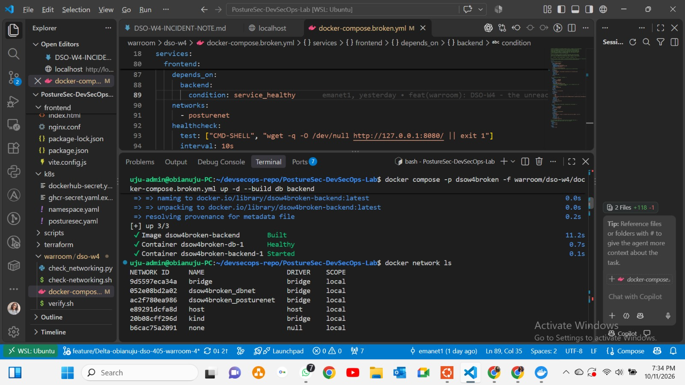
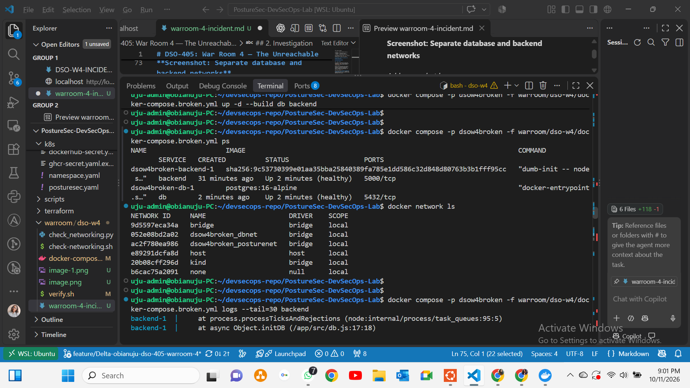
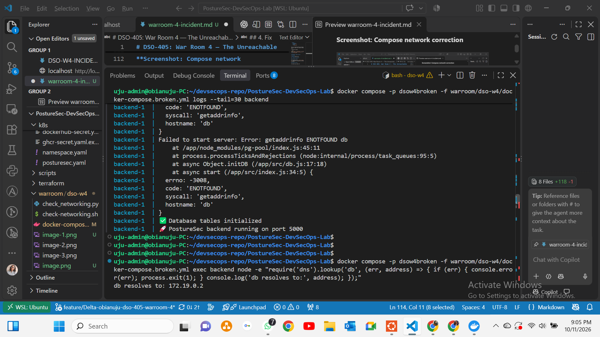
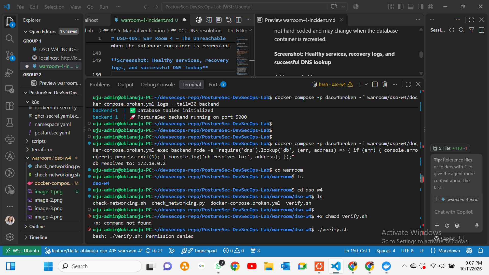
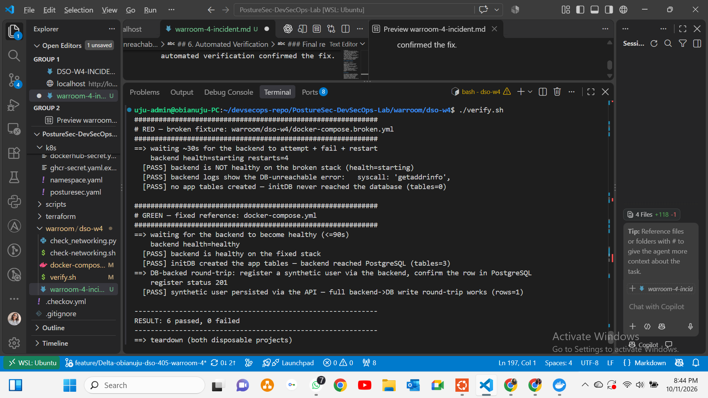

# DSO-405: War Room 4 — The Unreachable Database

**Sprint:** 4 — Compose & Service Networking  
**Environment:** Local incident simulation  
**Feature branch:** feature/Delta-obianuju-dso-405-warroom-4  
**Outcome:** Resolved — final verification returned 6 passed, 0 failed.

## Objective

Investigate why the backend could not reach PostgreSQL after a Docker Compose edit, identify and fix the network/DNS issue, and explain how service-name resolution restored connectivity.

## Incident Summary

I reproduced a database connectivity failure in the PostureSec backend. The backend repeatedly reported `getaddrinfo ENOTFOUND db` and could not complete startup.

Container inspection showed that PostgreSQL and the backend were attached to separate Docker networks. I tested a fix by placing both services on a shared network while keeping `DB_HOST=db`.

Both services became healthy, database initialisation succeeded, and a DNS lookup from the backend resolved `db`. After restoring the intentionally broken fixture, I ran the automated verification again. The final result was **6 passed, 0 failed**.

## 1. Symptoms and Impact

The backend logs repeatedly showed:

```text
Failed to start server: Error: getaddrinfo ENOTFOUND db
code: 'ENOTFOUND'
syscall: 'getaddrinfo'
hostname: 'db'
```

The failure occurred during `initDB()`, preventing the backend from completing startup and making the API unavailable.

`ENOTFOUND` indicated that the backend could not resolve the hostname `db` into an IP address. The connection had not reached the database authentication stage.

**Screenshot: Backend failure**



## 2. Investigation

I started the broken database and backend services from the repository root:

```bash
docker compose -p dsow4broken -f warroom/dso-w4/docker-compose.broken.yml up -d --build db backend
```

I checked service status and backend logs:

```bash
docker compose -p dsow4broken -f warroom/dso-w4/docker-compose.broken.yml ps
docker compose -p dsow4broken -f warroom/dso-w4/docker-compose.broken.yml logs --tail=50 backend
```

I then inspected each container’s network attachments:

```bash
docker inspect $(docker compose -p dsow4broken -f warroom/dso-w4/docker-compose.broken.yml ps -q db) --format '{{json .NetworkSettings.Networks}}'
```

```bash
docker inspect $(docker compose -p dsow4broken -f warroom/dso-w4/docker-compose.broken.yml ps -q backend) --format '{{json .NetworkSettings.Networks}}'
```

The results showed:

| Service | Network before the fix |
|---|---|
| Database | dsow4broken_dbnet |
| Backend | dsow4broken_posturenet |

The database had the alias `db`, but the backend did not share its network.

**Screenshot: Separate database and backend networks**



## 3. Root Cause

The Compose configuration placed the database on `dbnet` and the backend on `posturenet`, leaving them without a shared network.

Docker service-name DNS works between containers on shared user-defined networks. Because the backend did not share a network with PostgreSQL, it could not resolve `db`.

The root cause was **network separation breaking DNS resolution**. Changing the database password or port would not have addressed this failure.

## 4. Fix

I changed the database’s network attachment to `posturenet`, matching the backend, and kept `DB_HOST=db`.

The relevant configuration was:

```yaml
services:
  db:
    networks:
      - posturenet

  backend:
    environment:
      DB_HOST: db
    networks:
      - posturenet
```

This is an excerpt showing the relevant settings, rather than a complete Compose file.

I applied the change:

```bash
docker compose -p dsow4broken -f warroom/dso-w4/docker-compose.broken.yml up -d --build db backend
```

**Screenshot: Compose network correction**



## 5. Manual Verification

### Container health

After applying the fix, `docker compose ps` showed both the database and backend as healthy.

### Backend recovery

The backend logs ended with:

```text
✅ Database tables initialized
🚀 PostureSec backend running on port 5000
```

These messages confirmed that database initialisation succeeded and the backend completed startup.

### DNS resolution

I tested name resolution from inside the backend:

```bash
docker compose -p dsow4broken -f warroom/dso-w4/docker-compose.broken.yml exec backend node -e "require('dns').lookup('db', (err, address) => { if (err) { console.error(err); process.exit(1); } console.log('db resolves to:', address); });"
```

The result was:

```text
db resolves to: 172.19.0.2
```

This address was discovered through DNS. It was not hard-coded and may change when the database container is recreated.

**Screenshot: Healthy services, recovery logs, and successful DNS lookup**



## 6. Automated Verification

I ran the exercise’s verification script:

```bash
bash warroom/dso-w4/verify.sh
```

### Initial result: 4 passed, 2 failed

The first run returned two failures because I had repaired `docker-compose.broken.yml` during my investigation.

The script expected that fixture to fail, but the backend became healthy and created the application tables. The fixed reference passed all three GREEN checks.

### Restoring the intentional failure

I restored the separate networks in the broken fixture:

- Database on `dbnet`.
- Backend on `posturenet`.

This allowed the script to compare the intended failure against the fixed root-level `docker-compose.yml`.

### Final result: 6 passed, 0 failed

After restoring the broken fixture, I reran the script. All six checks passed.

The GREEN output confirmed:

| Check | Result |
|---|---|
| Backend health | Healthy |
| Application tables created | 3 |
| Test-user registration | HTTP 201 |
| Matching user record in PostgreSQL | 1 |
| Overall verification | **6 passed, 0 failed** |

The registration test demonstrated a complete API-to-database write: the backend accepted the request, and the script confirmed that PostgreSQL contained the new user.

The script then began tearing down both disposable projects.

**Screenshot: Final verification — 6 passed, 0 failed**



## 7. How Service DNS Resolved the Incident

Once the backend and PostgreSQL shared a network, Docker could resolve `db` to the database container’s current IP address.

The backend then connected to PostgreSQL, initialised the application tables, and completed startup.

The fix restored the network relationship required for service DNS. It did not require hard-coding an IP address or changing `DB_HOST`.

## 8. Prevention and Lessons Learned

- Check network attachments when reviewing Compose changes.
- Ensure the backend and database share at least one network.
- Use service names instead of container IP addresses.
- Distinguish DNS failures from port, authentication, and application failures.
- Confirm recovery through health status, logs, DNS resolution, and a database-backed request.
- Preserve intentionally broken fixtures so regression tests can verify both failure and recovery.
- For network isolation, the backend can join both an application network and a database network while PostgreSQL remains on the database network.

## 9. Acceptance Criteria

| Requirement | Evidence |
|---|---|
| Find the network/DNS root cause | Separate network attachments and ENOTFOUND logs |
| Apply and verify the fix | Healthy services and successful database initialisation |
| Explain service DNS | Shared-network resolution documented above |
| Validate failure and recovery | Automated verification: 6 passed, 0 failed |

## Conclusion

The incident was caused by separating the backend and database onto different Docker networks. Restoring a shared network enabled service-name DNS resolution and recovered backend connectivity. Manual checks and automated verification confirmed the fix.